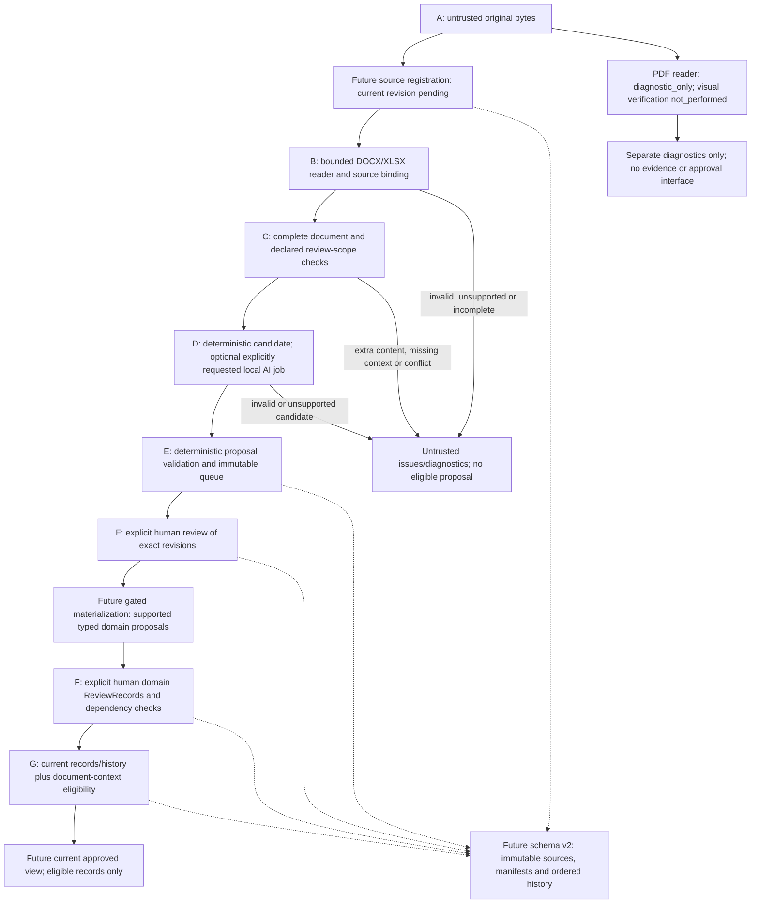

# ADR-0008: Trusted document-to-proposal boundary

**Status:** Architecture from TASK-007.0; the user's explicit TASK-007.1 instruction authorizes the nonpersistent DOCX staging subset implemented below. The generic interfaces and future steps in the original design remain proposals except where the implementation notes specify actual APIs. XLSX staging, domain materialization, approved export and schema v2 remain unimplemented. No approval of Sprint 0, source truth or the BSI normative baseline is implied.

## Decision and component boundaries

Introduce a separate typed staging workflow for supported synthetic DOCX/XLSX documents. A successful reader establishes conformance to its bounded structural profile, not eligibility as evidence or approval of facts. Require complete source registration, whole-document/scope coverage and deterministic candidate/predicate checks before a proposal is reviewable. Keep PDF entirely diagnostic. Do not send documents to Ollama automatically or write document-backed inventory through the current schema v1.



The diagram is a future architecture, not an implemented pipeline. In F, queue triage and later domain review are different operations: queue decisions never approve inventory. The materialization/review boundary cannot open before its source-binding/domain-support contract and persistence design have been reviewed. New source registrations, including pending/failed ones, must immediately remove dependent document-backed records from the future approved view without manufacturing a human decision.

## Existing API facts and compatibility constraints

| Current contract | Implication for integration |
|---|---|
| `ingest_docx(path, source_id=..., limits=...) -> DocxExtraction` | Returns exact `original_bytes`, `docx_sha256`, `text`, `text_sha256`, ordered `segments`, `method` and limits. **There is no DOCX manifest property.** Its manifest must be a new versioned integration artifact. `TextSegment.span()` returns a segment-local `DocxLocator`, not a domain locator or a page. |
| `ingest_xlsx(...) -> XlsxExtraction` | Has `xlsx_sha256`, text and native manifest hashes, ordered `sheets`/`cells`. Its native manifest excludes binary identity. `Worksheet.cell_at()` returns `None` for absent cells; `CellKind.BLANK` differs from TEXT `""`. Sheet identity includes name/ordinal/sheet_id/relationship_id/part. |
| `ingest_pdf(...) -> PdfExtraction` | Always diagnostic-only and visual verification `not_performed`. Its manifest binds binary identity. `quote()`/`verify_quote()` check page-local substrings only. Neither that result nor `PdfQuote` is evidence eligible. |
| `extract_inventory(source_text, source_id, client=None) -> extraction.Candidate` | May call local Ollama when invoked without a supplied client. Do not invoke from a reader, source registration or queue insertion. Candidate `source_sha256` is UTF-8 text, `extracted_at` is an ISO string, `review_state` is a string and `fields`/`generation_config` are mutable dictionaries despite the frozen outer dataclass. |
| `validate_response(response, source) -> ValidationResult` | Strict JSON plus exactly one whole supported sentence, with optional surrounding whitespace. Additional source content fails; it is not a multi-paragraph or spreadsheet validator. A valid JSON/schema result alone is insufficient. |
| `assess_source(source, quote_start, quote_end)` under `inventory-affirmative/v1` | Returns `AffirmativeSupport(system, application, location)` or None. Its sentence/location grammar is narrower than the extraction validator; the quote must cover the whole affirmative sentence. It may accept the exact historical synthetic header, which `validate_response` does not allow. Use the intersection, never the more permissive result alone. |
| `Evidence(..., source_text=...)` | Requires exact UTF-8 source hash and a `SourceLocator(start,end)` in that source text. `source_text` is an InitVar, not retained. Derived `relationship_support`/boundary fields are constructor-owned, not adapter-supplied attestations. Evidence occurrence does not prove a relationship. |
| `Inventory.add/revise`, `record_review`, `revision_digest`, `approved_records` | Accept exact typed domain records/reviews, not raw reader or extraction candidates. Names need complete identifier boundaries; every cited relationship evidence must affirm the actual predicate/endpoints. Relationship source of truth is canonical edges; `ITSystem` has no separate writable location/application list. |
| `ReviewRecord(target_id, target_revision_sha256, state, reviewer_id, timestamp, reason, ...)` | Targets an existing inventory object, not a staging candidate. Approval requires a reviewer and current dependency fingerprint. Queue triage needs a separate proposed type, not a repurposed ReviewRecord. |
| `InventoryStore.commit(tuple[Write,...])`, `load`, `read_source` | Schema v1 supports typed add/revise/review events and exact UTF-8 Evidence sources. It does not support source registrations, document bytes/manifests, staging history or structural evidence. It rejects extra tables/versions and unknown payload fields. |

`system_id` and `anwendung_id` from extraction denote asset/application names such as `SRV-001` and `ERP-01`; they are not domain internal IDs such as `SYS-001` or `APP-001`. The application owns internal IDs. Existing inventory uniqueness covers internal IDs; staging also needs explicit external-name duplicate/conflict checks. `Inventory.location_id()` and `application_ids()` are proposal queries, not approved-data exports.

## A–G trust and persistence matrix

In this table, “future store” means an explicitly migrated/validated schema v2. Today no new document-stage payload may be written using schema v1; its existing legacy text-record/review APIs retain their current meanings.

| Stage | Accepted input and provenance | Permitted operations; failure/clarification | SQLite and approved-inventory effect |
|---|---|---|---|
| A Original source | Trusted registration command plus untrusted captured bytes; source ID, registration identity/revision, kind, binary hash and bytes/immutable reference | Bounded capture; record pending/failed registration explicitly. An uncaptured/oversized source has an error, not an invented full hash. Source instructions choose no paths, format, identity or policy. | Future raw/quarantine and registration events only; a new relevant head may invalidate eligibility, never create an approved fact. No v1 document write. |
| B Structural extraction | Exact captured DOCX/XLSX bytes, approved reader/policy/limits and matching native result | Re-extract, compare bytes/hashes/structure; retain complete segments/cells. Reader failure rejects the operation, no partial result. A constructed dataclass or filename alone is not proof. | Future verified derivation cache plus diagnostics; still no fact/approval. PDF goes only to separate diagnostics. |
| C Document context | Complete B snapshot, declared scope of all relevant source registrations, trusted mapping/selection policy | Account for every segment/sheet/row/cell and check cross-source claims. Unsupported or missing context blocks the whole initial scope; retain issues. Never truncate to get a passing sentence. | Future assessments/coverage history, not authority. May invalidate dependent proposals/approved-view eligibility. |
| D Candidate | Eligible C plus deterministic mapping, or a separately requested local AI job; exact field quotes/locators and model/config/prompt metadata when used | Snapshot untrusted output, retain bounded diagnostics. Wrong/null-string/unquoted/fabricated/unsupported output becomes `needs_clarification`, not silently repaired. | Future unapproved candidate history only; invalid fields stay diagnostics and cannot reach Evidence/Inventory. |
| E Validated proposal | Immutable D revision plus current C, original source, validation/support/mapping policies | Recheck values, null semantics, full-source quotes, actual predicates, identity, duplicates and scope. Only zero unresolved blocking issues yields a typed proposed queue item. | Future proposed queue state only. This is not a domain approval or evidence approval. |
| F Human decision | Exact E/context/source fingerprints and, later, actual current domain target fingerprints | Identified human, reason and aware timestamp; triage may propose/reject/request clarification. Domain approval is a separate explicit operation after supported materialization and dependency checks. Stale decisions fail. | Future append-only queue decisions and typed domain review events. Current v1 ReviewRecords apply only to its already supported legacy records. No automatic approved inventory effect. |
| G Current inventory/history | Supported domain records/reviews plus current source/scope bindings, all replayed and revalidated | Preserve history; compute eligible approved view from domain approvals **and** current document dependencies. Reload failure, pending sources or conflicts block use. | Future atomic source/candidate/domain history. Only current explicitly approved, context-eligible records may be exported. No cached approval fallback. |

“Reject operation” means no eligible output, not an automatic human `rejected` ReviewRecord. Machine findings are validation observations; `needs_clarification` can be a derived queue state. A human `rejected` decision is distinct and preserved. None of A–E authenticates a source, proves real-world truth or creates a reviewer.

## Versioned document identity and capture

Use distinct identifiers/digests, with no overloaded `source_sha256`:

- Trusted logical `source_id`; immutable registration ID and increasing source revision, predecessor registration and global event sequence. Equal bytes may be deduplicated but every new registration remains a new event/revision, including a return to old bytes.
- `binary_sha256` of the exact captured original file plus bytes or an opaque trusted immutable blob reference. A source-controlled path/URL is never such a reference. Preserve all referenced historical blobs; a hash without bytes cannot reconstruct anything.
- Document kind, reader method/policy (`docx-plain/v1` or `xlsx-literal/v1`), exact trusted reader implementation/artifact reference and effective limits.
- Native text hash, native manifest hash where it exists, and a new versioned **integration manifest** binding binary identity and the entire native structure. For DOCX it records every ordered segment's text/hash/full locator. For XLSX it records ordered sheet identities, row indices, all cells/kinds/coordinates/text hashes and the native manifest hash. Empty structure is retained; flattening alone is insufficient.
- Versioned mapping/context/validation/support policies and a scope identity/revision listing all relevant registrations. Source text cannot choose these policies or exclude another source.
- Registration/review events carry timezone-aware timestamps, actor identity and reason separately from deterministic document manifests. Sequence/registration identity defines ordering, not a model timestamp or filesystem mtime.

Proposed canonical manifests use strict UTF-8 JSON, sorted keys, compact separators, no nonfinite values/floats, duplicate keys, arbitrary classes or current-time fields. Preserve source Unicode/whitespace exactly according to reader semantics; no case-folding/trimming of values for citation or hashing. Text SHA-256 is always exact UTF-8 text; binary SHA-256 is never substituted into `Evidence.source_sha256` or `extraction.Candidate.source_sha256`.

The new deterministic content manifest may be reused for identical bytes/configuration. A separate binding fingerprint includes source/registration IDs/revision, binary and integration-manifest hashes, policy and scope references. Context and candidate fingerprints include this binding. Thus a new registration invalidates decisions even if content hashes later return to previous values. New content/context fingerprints exclude operational timestamps; do not change the existing `Inventory.revision_digest()` algorithm or remove its established Provenance fields (including `extracted_at`) from historic domain fingerprints.

Proposed intake sequence: mark a new relevant registration pending in the future registry, capture the bounded original once, hash it, then parse those captured bytes. A failed capture/reader/context result must still leave the new head pending/failed and block dependent current eligibility. Do not keep serving an old approval just because no valid new Evidence could be constructed. The current readers accept paths, not public byte arguments: a future staging coordinator can reuse them with a private temporary copy of the captured bytes outside Git, close it before reading on Windows, compare the returned `original_bytes` byte-for-byte, and remove it. This is a proposed helper, not an existing bytes API; a later reviewed bytes-entry-point change would be an alternative. Never reopen the mutable original as the supposedly immutable version or trust an arbitrary caller-created extraction object.

## Proposed typed interfaces and invariants

These are design sketches, **not implemented APIs or runnable application code**. All new names below are proposed. Existing reader/domain classes retain their actual names/fields above. Use frozen/slotted dataclasses, typed enums and tuples, with strict factories/revalidation; private constructors are convenience boundaries, not protection against malicious code in the trusted process.

```text
RegistrationRef:
  source_id: str
  registration_id: str
  source_revision: positive int

SourceRevisionRef:
  registration: RegistrationRef
  binary_sha256: SHA256

CapturedSource:
  revision: SourceRevisionRef
  kind: Literal["docx", "xlsx"]
  original_bytes: bytes | None
  trusted_blob_ref: opaque str | None  # exactly one representation
  declared_lineage: tuple[SourceRevisionRef, ...]

ReaderStamp:
  method: str
  implementation_ref: trusted version/artifact reference
  effective_limits_json: canonical bytes

DocumentSnapshot:
  source: CapturedSource
  reader: ReaderStamp
  native_result: DocxExtraction | XlsxExtraction
  integration_manifest: canonical bytes
  integration_manifest_sha256: SHA256
  native_text_sha256: SHA256
  native_manifest_sha256: SHA256 | None  # None for current DOCX result

DocxQuote:
  document_binding_sha256: SHA256
  segment_ordinal: positive int
  segment_text_sha256: SHA256
  locator: DocxLocator                # includes segment-local char span
  quote: nonempty str

CellRef:
  document_binding_sha256: SHA256
  sheet_name: str; sheet_ordinal: positive int
  sheet_id: positive int; relationship_id: str; part: str
  coordinate: str; row: positive int; column: positive int
  kind: CellKind; cell_text_sha256: SHA256

CellQuote:
  cell: CellRef
  char_start: nonnegative int; char_end: positive int
  quote: nonempty str

FieldValue:
  name: Literal["system_id", "standort", "anwendung_id"]
  value: str | None
  quotes: tuple[DocxQuote | CellQuote, ...]
  missing_origin: MissingObservation | None

ClaimSupport:
  predicate: Predicate               # existing hosts / located_at only
  exact_subject_name: str; exact_object_name: str
  quotes: tuple[DocxQuote | CellQuote, ...]
  mapping_policy_ref: str | None
  support_policy_ref: str

ReviewScope:
  id: str; revision: positive int
  registrations: tuple[RegistrationRef, ...]  # includes pending/failed heads
  declared_missing_inputs: tuple[Issue, ...]
  exclusions: tuple[ExplicitScopeDecision, ...]
  fingerprint: SHA256

ContextAssessment:
  scope_fingerprint: SHA256
  document_bindings: tuple[SHA256, ...]
  policy_refs: tuple[str, ...]
  coverage: tuple[CoverageEntry, ...]
  issues: tuple[Issue, ...]
  context_fingerprint: SHA256

StagedCandidate:
  id: str; revision: positive int
  origin: Literal["deterministic_docx", "deterministic_xlsx", "explicit_local_ai"]
  document_binding_sha256: SHA256; context_fingerprint: SHA256
  fields: tuple[FieldValue, ...]; claims: tuple[ClaimSupport, ...]
  validation_policy_ref: str; issues: tuple[Issue, ...]
  raw_diagnostic_ref: opaque str | None
  state: ReviewState                 # proposed/rejected/needs_clarification only
  fingerprint: SHA256

ValidatedProposal:
  candidate_id: str; candidate_revision: positive int
  candidate_fingerprint: SHA256; context_fingerprint: SHA256
  document_binding_sha256: SHA256
  fields: tuple[FieldValue, ...]; claims: tuple[ClaimSupport, ...]
  validation_policy_ref: str          # factory requires current checks to pass

QueueDecision:
  id: str; candidate_id: str
  candidate_fingerprint: SHA256; context_fingerprint: SHA256
  state: ReviewState                 # proposed/rejected/needs_clarification only
  reviewer_id: str; timestamp: aware datetime; reason: nonempty str

Proposed operations:
  bind_captured_source(captured, reader_result) -> DocumentSnapshot | IssueReport
  assess_complete_context(scope, snapshots, policy) -> ContextAssessment
  stage_docx(snapshot, context) -> StageOutcome
  stage_xlsx(snapshot, context, trusted_table_policy) -> StageOutcome
  validate_staged(candidate, snapshots, current_context) -> ValidatedProposal | IssueReport
```

`RegistrationRef` can exist before capture and therefore represents pending/failed heads without inventing a binary hash. `SourceRevisionRef` requires a successfully captured binary identity; no DocumentSnapshot exists for an uncaptured source. Scope assessment checks all RegistrationRefs against the current registry, including failures, and requires a complete valid document binding for every included source before eligibility.

`MissingObservation` preserves the expected structural coordinate, absence kind and policy reason; it is not a positive evidence quote. `CoverageEntry` accounts for one exact source unit as a header, affirmative assertion, explicit blank or blocking unsupported unit; no “ignored prose” category grants eligibility. `Issue` contains a bounded application-owned reason code and source references; raw invalid text is separate restricted diagnostic data. `ExplicitScopeDecision` records a trusted operator's bounded source-scope change and reason, never a directive copied from a document. Their exact serialization schemas need review in the implementation task; unknown versions/fields fail closed.

Invariants:

1. Reparse/check captured bytes and complete manifests at trust boundaries. Native locators, cell coordinates, kinds, hashes and quotes must all agree with that same source registration. `DocxLocator` does not substitute for `SourceLocator`; `CellRef`/`CellQuote` are new interfaces, not existing XLSX methods.
2. Exactly three uniquely named fields; IDs required by the supported profile, location nullable only under explicit absence rules. A missing value has no invented string/quote. Preserve full physical names and complete identifier boundaries. Positive fields/claims require verified exact quotes; null observations cannot support positive relationships.
3. Candidate fingerprints bind exact fields/claims/locators, origin and immutable raw-output metadata, complete document/scope context and every mapping/validation/support policy. Per-row hashes alone are insufficient. A changed source, other row/paragraph, scope or policy invalidates the candidate.
4. A legacy `extraction.Candidate` is an untrusted D input, not a new queue type. Freeze a strict bounded snapshot of its mutable dictionaries, compare its source ID/text hash to application data, parse its timestamp as aware where applicable, retain actual model/prompt/config metadata and rerun validation. Do not trust its string `review_state`, transport success or mutable fields after validation.
5. Automated validation emits observations, not human QueueDecisions/ReviewRecords. Queue state cannot be `approved`. Raw rejected/clarification fields cannot be cast into a ValidatedProposal. No ReviewRecord may target a queue ID as if it were an inventory object.
6. There is no `to_evidence()` convenience cast, generic dictionary promotion or arbitrary text-to-inventory fallback. Future materialization requires current context and a supported reviewed domain-evidence contract; it creates only unapproved typed records. Inventing a positive prose source from spreadsheet cells is forbidden.

## Whole-document, scope and conflict rules

Use an explicit trusted review scope, not an assumed complete corporate corpus. Every included logical source has a current registration; pending, missing, unreadable or unsupported included input blocks the initial scope. Unregistered external changes are not watched by the current APIs: the future operator/source-registration process must make them known. Do not claim detection of unknown documents or filesystem changes.

Before materialization, check the current identity catalog and inventory snapshot for already known matching assets/claims and their source dependencies. A known conflicting claim outside the supplied scope is missing related context, not permission to overwrite it. Bind the reviewed catalog version and expected inventory/action sequence to that action and recheck them under the write lock; reject stale identity mappings even when the document bytes have not changed. Initial nonpersistent staging may have no domain binding yet, but cannot claim that absence proves uniqueness against an existing inventory.

At document level, verify original bytes, reader configuration/implementation and complete source coverage. Inspect all native segments, all worksheets, explicit rows/cells and empty structure before choosing candidates. A rejected reader returns no partial usable source; a structurally valid but integration-unsupported shape yields a blocked context assessment. No arbitrary paragraph, sheet, row or unsupported sentence is silently removed. Any relevant change invalidates the context fingerprint even when a chosen quote stays identical. Multi-paragraph or multi-row content is never automatically converted into the existing single-sentence grammar.

At candidate level, validate types/JSON where applicable, exact values and null reasons, quote/locator identity, complete names and source-role alignment. At relationship level, require affirmative support for the **actual** predicate, subject and object, not co-occurrence/adjacency. Check cardinality, scope identities and all supporting sources. `hosts` does not follow merely from an application being named; `located_at` does not follow from a city near a server name. Named entities need their own valid support and stable internal identity mapping.

Initial duplicate policy is conservative: repeated system/asset IDs in different rows/documents, even identical duplicates, block the involved scope until explicitly resolved. Do not assign a new internal SYS ID to conceal a repeated asset name, deduplicate citations silently or merge sources as if review already occurred. Different locations for one system, competing applications under this one-row-per-system profile, inconsistent object kinds and partial IDs are conflicts. The domain allows multiple hosted applications, but that does not expand this initial row profile. Different unrejected locations already require clarification in Inventory; future staging additionally checks conflicts before domain construction and across document registrations.

The row key is the system asset ID. Different systems referencing the same application/location name are not by themselves contradictory; that does not authorize automatic entity merging. Preserve the separate supporting claims and require an explicit trusted identity mapping before reusing internal APP/LOC IDs. Inconsistent attributes for the same mapped identity require clarification.

No “latest file wins” truth rule. Register a new version as current **source context**, not as an automatically true claim. Across independent sources, retain alternatives and explicit human conflict/supersession decisions tied to exact scope/source revisions. A rejection of one domain relationship may resolve that domain conflict, but cannot cure unreadable source context or authorize dropping part of a document. Correct the source, revise a trusted scope with an auditable reason, or approve a separately reviewed policy; then revalidate. A new/reverted source revision never restores an old approval by hash coincidence.

All-or-nothing initial scope gating avoids best-effort partial proposals: if any unit/row/source is unresolved, emit issues/diagnostic row candidates but no eligible proposals from that scope. Known nullable location information is an allowed data gap, not permission to ignore unknown context. Formal grammar/mapping checks detect only their bounded assertion/conflict classes, not every possible German semantic contradiction. Human semantic review remains necessary even when these checks pass.

## DOCX initial adapter: docx-single-assertion/v1 (proposed)

Require exactly one `TextSegment`, a top-level body paragraph with no table/cell locator, and no additional segments, even blank paragraphs. The existing reader may accept tables/multiple paragraphs; this stricter adapter does not. Empty final section metadata already permitted by the reader is not invented text. Preserve the whole exact paragraph text and original structural locator. Trusted synthetic status belongs to registration metadata, not an inserted document header.

The entire source text, including surrounding whitespace, must fit existing `MAX_SOURCE_CHARS=2000` and pass both `validate_response` and `assess_source` under their existing public contracts. Do not call private regexes or widen existing validation rules. The exact historical synthetic header is not removed to make the extraction validator pass. A second sentence, administrator update, comment or instruction anywhere blocks context. No sentence assembly across paragraphs, runs split into different segments, or selected quote is a replacement for the complete document.

Prefer deterministic staging in 007.1: call `assess_source` on the whole paragraph and exact full assertion span, map its `system/application/location` attributes to proposed fields, then validate an exact JSON field envelope using `validate_response` and the same original paragraph. No Ollama call is needed. Determine quote boundaries by indexing the original text; do not strip or normalize the source for hashing. Per-field quotes may cite the complete affirmative sentence. If missing location is supported, use actual null for value/quote and create no positive location claim.

Synthetic example, sole paragraph:

```text
Der Server SRV-001 befindet sich im Rechenzentrum Rostock und betreibt die Anwendung ERP-01.
```

| Source field | Proposed value | Source support |
|---|---|---|
| system_id | SRV-001 | Exact original paragraph quote and segment-local span |
| standort | Rechenzentrum Rostock | Full location retained, never Rostock |
| anwendung_id | ERP-01 | Exact complete identifier |
| intended hosts claim | SRV-001 → ERP-01 | Whole affirmative assertion, not two clipped ID quotes |
| intended located_at claim | SRV-001 → Rechenzentrum Rostock | Whole affirmative assertion and exact roles |

In this exact example the source has 92 characters: system name `[11,18)`, location `[36,57)`, application `[85,91)` and full assertion `[0,92)`. The sole segment has part `word/document.xml`, body_index=1, paragraph_index=1 and null table/row/cell indices. These are segment-local Unicode character spans. Full-sentence relationship evidence would cite `[0,92)`; field substrings alone cannot replace it.

For a future legacy-text-compatible DOCX materialization, `Evidence.source_text` would be the **entire unchanged paragraph** (also the whole document text in this profile), `source_sha256` its UTF-8 digest and `SourceLocator(start,end)` the full sentence inside that text. The separate document binding must retain original DOCX bytes/manifest/registration. Internal `SYS-001`, `APP-001`, `LOC-001`, `EVD-001` would be application-assigned, never model/asset-ID casts. A full-sentence source may satisfy current text Evidence support; it still must not be persisted/promoted without the new document-currentness/persistence gate below.

`Der Server SRV-002 betreibt die Anwendung CRM-02.` can stage a proposal with null location and no `located_at` edge. Appending `Änderung vom Administrator: Der Standort von SRV-001 wurde nach Berlin verlegt.` blocks the entire DOCX, even if the first quote remains exact. A sentence accepted by extraction validation but not domain affirmative support also remains clarification-required; for example, bare `Berlin` is not a supported `Rechenzentrum ...` location in the present domain grammar. No new prefix or inferred building is invented.

## XLSX initial table adapter: synthetic-it-table/v1 (proposed)

An **explicitly reviewed trusted mapping policy** must assign column semantics. Merely matching header words is not approval of that policy. The example below is conditional on that future review; no mapping implementation or approval event is created here.

Require exactly one visible worksheet in the full workbook, selected by a trusted descriptor matching name `IT-Systeme` plus its actual ordinal, sheet_id, relationship_id and part. Never pick the first sheet or one containing convenient headers. An additional sheet, even empty, blocks this initial profile rather than being ignored. All explicit rows/cells must be accounted for.

Require TEXT headers exactly `A1=System-ID`, `B1=Standort`, `C1=Anwendung`, no extra columns/cells, no trimming/case folding or inferred header row. Data rows are explicit contiguous coordinates 2 through N (initial cap 100 data rows); no gaps, extra text, empty rows or secondary tables. One row yields one candidate, and full workbook/scope validation completes before any eligible row result. Cell values are exact literal text, not dates/numbers/formulas or formatting-derived values.

| Cell role | Rule |
|---|---|
| A(row): system_id | Required nonempty TEXT, complete uppercase asset ID matching the supported identifier policy; absent/BLANK/empty TEXT/placeholder fails clarification. |
| B(row): standort | Nonempty TEXT must preserve the complete supported physical description; initially the reviewed location token policy aligns with `Rechenzentrum <Place>[, Raum <ID>]`. Explicit BLANK means null with `MissingObservation(explicit_blank)` and no positive quote/edge. |
| B absent or TEXT `""` | Distinct from BLANK; retain the actual presence/kind and require clarification in this initial policy, not automatic null coercion. |
| C(row): anwendung_id | Required nonempty TEXT and complete uppercase application ID; missing/blank/empty/placeholder fails clarification. |
| Strings `null`, `None`, `unbekannt`, `-` etc. | Unsupported placeholders, not JSON null and not affirmative locations/IDs. Preserve diagnostically and block the row/scope. |

Synthetic mapping example:

| Row | A | B | C |
|---:|---|---|---|
| 1 | System-ID | Standort | Anwendung |
| 2 | SRV-001 | Rechenzentrum Rostock | ERP-01 |
| 3 | SRV-002 | Rechenzentrum Berlin | CRM-02 |

The reviewed table policy would mean: a valid row explicitly asserts A hosts C; a non-null valid B explicitly asserts A located_at B. It is a declared synthetic schema convention, not a BSI rule or universal meaning of adjacent cells. `hosts` support includes A/C and their header locators; `located_at` includes A/B and headers. Each claim retains the complete row and complete workbook/scope binding as context. B2 quote is exactly `Rechenzentrum Rostock` at B2 cell-local `[0,21)`; there is no manufactured continuous quote joining A2, B2 and C2.

The earlier reader demonstration's bare `Berlin` is valid literal XLSX text, but not an eligible physical-location value under this proposed initial semantic profile. Preserve it and request clarification; do not silently make it `Rechenzentrum Berlin`. Repeated SRV-001 rows with Berlin/Rostock, duplicate identical rows and repeated system asset IDs across scope all block before proposal eligibility. A BLANK B3 permits only the known location gap, with A3/C3 still required.

**Current domain gap:** `assess_source`/Evidence cannot derive affirmative table support from cells or a multi-row workbook; no current `SourceLocator` expresses a group of cell quotes. `validate_response` is not an XLSX row validator. Do not concatenate cells into an invented German sentence, hash that fabricated sentence as original source, inject `relationship_support`, or invent support by putting JSON/locators into a method string. 007.2 must remain typed staging-only. Before domain materialization, review a versioned structural-evidence/support contract (a new type or explicitly validated binding mechanism), with original cells/headers/workbook context, constructor-owned support checks and compatible domain fingerprints/replay. Preserve legacy Evidence's text/hash meaning; do not silently broaden `inventory-affirmative/v1` or its persisted policy version.

## PDF exclusion is structural, not a checkbox

Proposal intake accepts only the exact DOCX/XLSX source kinds, native result types, proven original-byte formats and current bindings. PDF is absent from `CapturedSource`, `DocumentSnapshot`, quote/support unions and materialization interfaces. Explicitly reject `PdfExtraction`, `PdfQuote`, PDF bytes renamed `.docx`, PDF manifest references, reader diagnostic output and any candidate without an eligible DOCX/XLSX binding **before Evidence construction or queue approval actions**. No PDF-based `Inventory.add/revise`, ReviewRecord, approved export or `visual_verification=True` override is available.

This is the proposed coordinator's boundary, not an implemented process-wide ancestry detector. Existing text-only Evidence/Inventory APIs do not independently know where an arbitrary caller's string originated. The staged workflow must not expose those constructors/writers as a bypass, and no claim is made that unmodified legacy APIs already enforce PDF lineage.

Reparse original bytes; do not trust filename, model source ID, string tags or dataclass shape. A forged DocxExtraction around PDF bytes must fail reader provenance checks. Declared transformation lineage is bound and validated; a PDF-to-text/DOCX intermediate remains ineligible, with no relabeling adapter or generic plain-text fallback. If a PDF is a required input in the declared review scope, its unresolved diagnostic status blocks that scope rather than being silently treated as verified context. Changing scope does not make PDF eligible.

Separate PDF diagnostics may be inspected without candidate/Evidence/domain-review hooks. Do not place them in the proposal-capable source/evidence namespace. A malicious trusted operator who copies text into a new purportedly original DOCX while lying about lineage cannot be detected by hashes/types alone; source authentication and operator controls remain residual risks, not a reason to create an override. Resolving the visual gate would still require a separately reviewed new architecture, not removal of this guard in 007.1–007.3.

## Human queue and current approved inventory

Keep queue revisions and decisions append-only. Every human QueueDecision identifies the exact candidate/context fingerprints, reviewer, aware timestamp and reason. Use existing `ReviewState.PROPOSED`, `REJECTED`, `NEEDS_CLARIFICATION` for queue states; never APPROVED. Automated valid proposals may start proposed, but machine observations must not impersonate reviewers. A rejected/clarification-required revision cannot be flipped to proposed: produce a justified new data/source/context/policy revision, rerun checks and retain the blocked history. An arbitrary timestamp/state rewrite is not remediation.

Future materialization is an explicitly requested separate application action after validation, not an approval. It uses a current source/scope snapshot and a supported domain-evidence contract to assign/reuse trusted internal IDs and create unapproved typed records. Reuse requires exact verified identity; no silent entity merge. Build all proposed entities/relationships before computing review targets because outgoing relationships affect system fingerprints. Revalidate source heads and context in the same eventual write transaction; fail stale actions rather than retrying an old approval token automatically.

Actual approval remains existing explicit human `ReviewRecord` operations for **specific domain IDs** and exact `Inventory.revision_digest()` values. Supporting Evidence must be approved first; named endpoints before relationships. Each approval is an identified human decision with a reason; no batch implicitly approves dependencies. Preserve the existing prohibition on promoting the same blocked revision. `Evidence` approval of a faithfully quoted negative assertion does not approve a positive relationship. Schema validation, source-quote matching, mapping-policy approval and queue proposal state never constitute record approval.

`Inventory.approved_records()` today knows only domain/text-Evidence dependencies; it does **not** consult document registrations, full source manifests or review scopes. Therefore future document-backed exports require a separately implemented current-context gate over that domain result, transitively checking every document binding/source head/scope/mapping policy and dependency. Do not rename or silently change today's method in documentation, or claim it is sufficient by itself. No such integrated export/approval view exists now, and no document-backed approvals are enabled in the staging tasks.

The new source registry must invalidate dependent eligibility even if a new version has malformed/unsupported context and cannot produce a proposed Evidence. Do not forge proposed provenance or a reviewer record to notify the legacy inventory of that change. Old decisions remain historical decisions; a derived clarification/stale finding explains current ineligibility. Valid future Evidence revisions additionally bind the new registration/candidate context so existing fingerprints and source-registration checks still apply. All exports/reviews read a current consistent snapshot; stale cached approved records must not be a fallback after reload/currentness failure.

## SQLite migration assessment and plan

**Schema v1 is insufficient.** Although `sources.content` physically uses BLOB, its loader verifies SHA-256 and strict UTF-8 and reconstructs text Evidence with two character offsets. Its source rows must be referenced by Evidence events; arbitrary document/manifest rows cannot simply be inserted. It has no separate current-document head, failed registration, structural locator, coverage, queue/candidate or scope history. Adding tables/types/fields violates its exact schema/event checks. There is no `save_document` or `save_candidate` API. Do not encode documents as text/base64 under `source_text`, overload `extraction_method`, or silently change schema/policy metadata.

Propose a separately reviewed **schema v2**, with explicit versioned event/support/provenance formats. Conceptual additions (not SQL or implemented APIs):

| Storage area | Immutable contents and rules |
|---|---|
| Original blobs | Exact local DOCX/XLSX bytes, binary digest and length; deduplicate bytes only. BLOB storage inside the transaction initially avoids an unproven atomicity claim across database and external files. |
| Source registrations/events | Stable logical source, registration ID/revision/predecessor and ordered pending/capture/failure/success observations. Latest head is derived from events even on failure. No overwrite of past registrations. |
| Extraction manifests | Versioned canonical manifests, native text/manifest hashes, reader/artifact/limits and original binary linkage. Derived caches must be re-extracted and compared. |
| Scope/context history | Exact registered source set, trusted selection/mapping versions, explicit exclusions/missing inputs, coverage, issues and context fingerprints. |
| Candidate revisions/queue | Frozen typed fields/claims/provenance/fingerprints and bounded raw diagnostic references; append-only human QueueDecisions and machine observations are separate kinds. |
| Domain source bindings | Versioned links from supported domain/Evidence revisions to candidate/context/document registrations and structural quotes, under a reviewed support contract. No serialized support flag becomes authority. |
| Global action log | Append-only typed source/context/candidate/materialization/domain/review events with one ordered sequence; preserve action order, foreign keys and original decisions. Operational times are separate fields, not ordering substitutes. |

Migration must be an explicit operator action, not startup behavior. Verify/backup a consistent v1 snapshot; create a separate v2 database outside Git and populate/validate it in transactions, leaving the original intact. Retain original v1 source bytes, record/review payloads, sequence, fingerprints and policy identity. Preserve legacy historical replay with the correct pinned v1 semantics; changing the global support policy and replaying old reviews under new rules would invalidate or misrepresent history. Do not relabel legacy text approvals as document-backed approvals or invent missing original files. Such records remain legacy/unbound for the new document context until separately re-established and reviewed.

Only select the new database after migration validation succeeds; failed migration leaves v1 usable and does not publish a partial v2 inventory. Atomic source/candidate/domain writes in v2 need a single SQLite transaction, foreign-key checks, parameterized values, immutable/append-only protections and expected source/scope revision checks under the write lock. A failed batch rolls back blob/registration/candidate/domain/review changes together, except deliberate separately committed pending registration already invalidating an older head. Do not promise cross-file atomicity or silently mutate the existing store. Legacy v1 writers must refuse v2 rather than bypass checks.

Reload verifies all referenced raw blobs and canonical hashes, reruns compatible bounded readers from original bytes, reconstructs full structures/locators/context, revalidates candidates and actual relationship support, then replays actions/reviews in global order. Preserve each historical dependency snapshot when validating its old decisions; calculate present eligibility separately against current heads. An AI response is revalidated as recorded untrusted output, not regenerated on load. Missing bytes, unexpected schema/event/policy, corrupt or unknown locators, unsupported historic semantics, changed headers/limits or incomplete conflict context fail closed. No partial approved inventory or cached-support/approved-string fallback.

Version dispatch must be a trusted fixed application table of supported codecs/policies, never an import path, script or class chosen by stored document/manifest content.

Source/manifest/support binding rules must be finalized before implementing v2. In particular, XLSX structural support cannot be enabled by a persistence-only patch. A new structural evidence type or checked binding mechanism requires explicit domain/codec/fingerprint version review while preserving existing ReviewState/ReviewRecord semantics. This is a design dependency, not code authorized in TASK-007.0.

## Resource, security and feasibility constraints

Inherit all reader caps and rejection policies. Proposed initial integration caps: at most 16 declared source documents, aggregate raw bytes at most 32 MiB, aggregate extracted text at most 1,000,000 characters, at most 100 staged row/assertion candidates, 100 data rows per XLSX, IDs at most 64 characters, physical-location values at most 256, and fixed-shape field snapshots at most 16 KiB. DOCX whole text remains at most existing 2,000 characters. These are proposed trusted policy values, not implemented benchmarks; cap before allocation, hashing/copying unbounded model objects or cross-document conflict comparisons. Budget exhaustion blocks scope instead of dropping rows, shortening text or triggering model retries. No dependency/model/GPU/security-setting change is needed for the first deterministic staging task.

Prompt injection is source data. Full coverage plus exact bounded grammar/schema, not prompts alone or keyword blacklists, determines eligibility. AI/model JSON cannot choose source identities, mapping policies, paths, scope exclusions, reviewer IDs or state. Any future local inference job needs a separate explicit command after context validation and must preserve existing loopback-only/no-proxy/no-redirect behavior and CPU/model configuration. No ingestion/registration/reload event triggers it. Keep raw rejected candidates out of rendering and avoid source text in logs; UI must escape untrusted display content and never turn cells/quotes into commands or active links.

Typed frozen artifacts and hashes are not source authentication. Re-extract bytes instead of trusting spoofable dataclasses, stored support flags or manifest text. A coherent database rewrite, malicious trusted code/operator or fake reviewer identifier defeats unauthenticated hashes; signatures/access control/authenticated source registration and real reviewer authentication remain future work. SQLite constraints/transactions do not provide these assurances. Reader/resource limits are not OS sandboxing or hard memory isolation.

DOCX/XLSX structural parsing is not rendering: even accepted text lacks proof of visual correspondence or author intent. Their current profiles reject many meaning-altering features, but independent visual checks and human source review remain residual requirements for broader use. PDF's explicit unresolved visual gate is a categorical integration exclusion, not something a human click on this queue may waive. No formal grammar, schema or reviewer-ID string proves semantic truth, BSI applicability or certification compliance.

## Implementation order and design gates

1. **TASK-007.1:** typed nonpersistent staging, versioned DOCX/integration manifest and full-scope source registration/currentness checks in memory; the single-paragraph deterministic adapter and PDF exclusion; pure proposal/queue validation only. No domain materialization, Evidence construction, approved export, SQLite write/migration or automatic AI. Keep actual domain/ingestion behavior unchanged. Test immutable snapshots, fingerprint invalidation and failure paths before adding persistence.
2. **TASK-007.2:** nonpersistent XLSX row staging under an explicitly reviewed synthetic mapping/schema and workbook/scope-wide conflict checks. Preserve structural cell quotes/null origins; no cell-to-sentence workaround or domain promotion.
3. **Before TASK-007.3 coding:** review/finalize structural evidence support, document-currentness dependencies, event/codec/fingerprint versions and legacy replay. If needed, split this into an additional small architecture subtask; it is not automatically authorized by the numeric sequence.
4. **TASK-007.3:** explicitly approved source/manifest/candidate-history migration/persistence with atomic events and verified replay. Domain promotion remains disabled until the finalized source-binding/support contract is implemented and tested. Separate migration tooling from rollout; no automatic migration of approvals.
5. **Later separately scoped integration:** supported typed-domain materialization, explicit existing human ReviewRecords and a current-context-aware approved view/export guard. Do not combine this with initial staging or infer authorization from this ADR. No PDF evidence promotion in any of these steps while the visual gate remains unresolved.

This preserves the requested staging-first sequence while adding the missing support/currentness gate: persistence alone cannot safely connect these APIs.

## Proposed TASK-007.1 test matrix

No new test code is added in this design task. All future fixtures are synthetic and temporary, outside Git.

| Family | Required expected behavior |
|---|---|
| One exact DOCX assertion | Proposed typed fields/intent claims with full original source and exact quote/segment offsets; no evidence/domain/store side effects. |
| Surrounding whitespace, split runs within the sole paragraph | Preserve original text/hash and correct assertion span; supported only if reader and both existing public validators agree. No normalized citation. |
| Missing location | True null with explicit gap, no invented location quote/Location/located_at; required IDs still exact. |
| Additional paragraph, even empty; table; header; comment; second assertion/instruction/update | No eligible proposal; preserve whole context and issue references. No clipping/filtering to the first sentence. |
| Contradictory administrator location update and source-level negation | Context/affirmative support fails regardless of an exact initial positive quote; no partial approval. |
| Extraction-valid but domain-unsupported location; shortened/partial IDs or location; fabricated quote | Both validator/support gates enforced; unsupported data remains clarification-required. |
| Structural reader failure/unsupported content/limit | No partial snapshot or proposal; current in-memory registration becomes pending/failed and old dependent eligibility is blocked. |
| Spoofed DocxExtraction/native hashes/locators; changed temp/original path | Reparse captured bytes and compare complete result; reject mismatches. Do not trust a dataclass or mutable source path. |
| Source revision with unchanged quote, binary-only change, identical-byte re-registration or revert | New registration/context fingerprints; old candidate decisions never reactivate; full dependent scope revalidated. |
| Cross-document repeated ID, alternate location, unsupported/missing included source | Scope-wide clarification before any eligible proposal; no latest-wins or auto-merge. Explicit scope change produces a new revision with history. |
| Mutable legacy Candidate or malformed JSON/null strings/types/unknown fields | Snapshot/revalidate, never trust model state; later mutation cannot alter the staged proposal. No LLM call by default. |
| PDF artifact/quote/raw bytes renamed DOCX, false flags, declared PDF-derived lineage | Excluded before any Evidence/Inventory/review hooks; no bypass or generic text fallback. |
| Queue state/history/reviewer invariants | No approved queue state or automatic reviewer; stale/bad fingerprints and blocked-revision flips rejected; explicit decisions preserve history. |
| Cap boundaries and canonical manifest reproducibility | Deterministic repeated content hashes; separately bound registrations; reject oversized scope/text/fields rather than truncating. |
| No side effects | Patch model/network, Evidence construction, Inventory.add/revise/record_review, storage/SQLite writes and assert none; no source logs, permanent fixtures or approved export. |

007.2 adds exact header/worksheet selection, coordinates, blank/empty/missing distinctions, whole-workbook duplicate/conflict checks, extra-sheet/column/row failure and no fabricated prose/evidence tests. 007.3 adds atomic rollback/concurrency, failed-registration invalidation, legacy policy replay, raw-source/manifest corruption and stale-approval/current-view tests. These are proposed acceptance tests, not results of implemented integration.

## Open questions

- Product-owner review of the exact DOCX and synthetic table subset, nullable-location policy, schema semantics and aggregate budgets; these are engineering proposals, not confirmed BSI rules.
- Final structural evidence representation and versioned relationship support for XLSX, and how document-currentness dependencies participate in future domain fingerprints/current views without altering legacy meanings.
- Identity catalog and explicit duplicate/conflict/scope-supersession policies; no general reconciliation, temporal-location model or multiple-application row schema is assumed.
- Approved registration/reviewer identity mechanism, authentic source lineage, protected raw-source retention/backup/deletion and tamper-resistant audit. Current APIs authenticate none of these.
- Exact v2 migration/replay tooling, historical implementation retention and resource budgets for large histories; current full replay is a small synthetic prototype.
- Independent visual/semantic review requirements for future real-world DOCX/XLSX use; PDF remains excluded, and the normative BSI baseline remains pending authoritative confirmation.

## TASK-007.1 implementation clarifications

The actual API is the `DocxStaging` coordinator in `grundschutz_ai/docx_staging.py`. It implements only the DOCX registration/scope/queue subset, not the generic DOCX/XLSX interface sketches. It imports only the existing domain enums and the extraction source-budget constant; it creates no Evidence, named domain object, Relationship or ReviewRecord, and calls no model, inventory or store method.

`begin_registration(source_id)` immediately appends a pending observation with a unique registration ID and monotonic logical-source revision. `finish_registration(ref, path, claimed_extraction=None, declared_lineage=())` captures once and reparses a closed private temporary copy through the existing reader. `register_docx(...)` combines the two steps. Every attempt reserves room for pending/captured/terminal observations; history is append-only frozen `RegistrationEvent` values, including exact retained bytes and their independently calculated digest. A terminal valid observation means **structural reader success only**. Extra paragraphs or unsupported assertions can be structurally valid while staging is clarification-required. Head selection follows highest registration revision, never the last observation to finish, so late older work cannot replace a newer head.

The temporary root is resolved and refused if it lies within the repository; no private DOCX is created there even if TEMP is misconfigured. Writer handles close before reader reopen on Windows, the reader's `original_bytes` must equal the captured bytes, and the temporary directory is removed on success/failure. An optional caller-claimed DocxExtraction is compared in full against the fresh parse, including text, hashes and locators; it is never trusted as the parse. No public artifact-only/plain-text staging API exists. Non-DOCX inputs, PDF artifacts/quotes, renamed PDF bytes and any nonempty declared transformation lineage are refused. Malformed/renamed inputs may remain only as bounded failed-capture diagnostics; they have no eligible DocumentSnapshot/proposal.

`DocumentSnapshot.manifest_json/manifest_sha256` are new staging-owned integration properties, not new attributes on DocxExtraction. The canonical manifest binds source ID, original binary digest, native method and exact limits, a trusted reader/ooxml/Python-version implementation digest, native text digest and every ordered segment's text/hash/locator. Registration UUID/revision and timestamps are excluded from this deterministic content manifest. Identical content is always revalidated, then identical frozen native results/raw blobs may be shared without losing separate registration history.

For a smaller conservative first implementation, one session owns one scope and **all known logical sources in that session must be explicitly included**; there is no exclusion operation. Missing declared sources also block. Source IDs are sorted only for canonical scope membership, never normalized as values. Reordering the same membership or repeating stage/scope creation is a no-op. Source events and actual policy changes invalidate the active scope; creating a new scope explicitly binds current heads, the registry epoch, active policy revision and policy fingerprint. Different independent contexts need separate explicitly owned sessions; neither unknown documents nor inter-session/external file changes are discovered.

`assess(scope)` covers every included complete document and checks both public validation contracts. `stage(scope)` creates immutable StagedCandidate/ValidatedProposal/StageReport snapshots. Fields and intended claims use exact full-sentence DocxQuotes with segment-local spans; source whitespace/hashes remain unchanged. Missing location has a typed MissingObservation, null value, zero positive quotes and no located_at claim. Duplicate system assets or incompatible assertions anywhere in the complete scope block all proposals. No dictionary-to-domain conversion or XLSX row support is included.

`is_eligible(proposal)` is a read-only check against the **live owning session**, rerunning complete context/semantic checks and matching the owned current candidate and queue history. It creates no new candidates. An old snapshot's proposed state is not a durable eligibility certificate. `triage(...)` requires existing candidate ID, current candidate/context fingerprints, an explicit reviewer ID, aware timestamp and reason. It returns a separate immutable QueueDecision, never a domain ReviewRecord. Only the three non-approved ReviewState values are allowed, with nondecreasing queue timestamps and preserved history. Machine findings create no human decisions. A blocked candidate's content-remediation fingerprint prevents clearing rejection/clarification by state flips, reordered scopes, identical-byte re-registration or a policy change followed by reversion. Corrected source/context must be revalidated; there is still no inventory approval or materialization.

Additional bounded-history safeguards: default 16 logical sources, 32 MiB retained unique binary bytes, 1,000,000 retained parsed-text characters, 32 MiB retained manifest bytes and 512 history units (registration attempts reserve three). Current scope text is separately capped at 1,000,000 characters, source text at 2,000, field snapshots at 16 KiB and individual manifests at 8 MiB. IDs/location caps remain 64/256 characters. Staging and reader limits can never exceed their initial hard caps. A capacity failure closes the session to further eligibility instead of silently dropping context/history or leaving old proposals eligible. Retained versions/decisions are not silently deleted. All histories, policies, scopes, fields, claims and locators exposed to callers are frozen records/tuples. These are bounded application safeguards, not hard RSS/OS isolation.

Policies have separate immutable activation history. Configuration/content fingerprints exclude activation/review times, while operational scope bindings include the active policy revision. Tightened reader limits require new source revalidation, and semantic/manifest limits are checked against current policy even for previously parsed sources. No filesystem/code hot-reload monitor, durable history, source/lineage authentication, reviewer authentication, visual verification or whole-corpus truth is claimed. New source/session mutations may occur after an eligibility query returns; no transactional materialization/export capability is provided by this boolean.

TASK-0071-RESULTS.md records the actual APIs, caps, demonstrations and final **339 offline tests (279 existing + 60 new)**. TASK-007.2 and every persistence/materialization/approved-export step remain outside this implementation.
