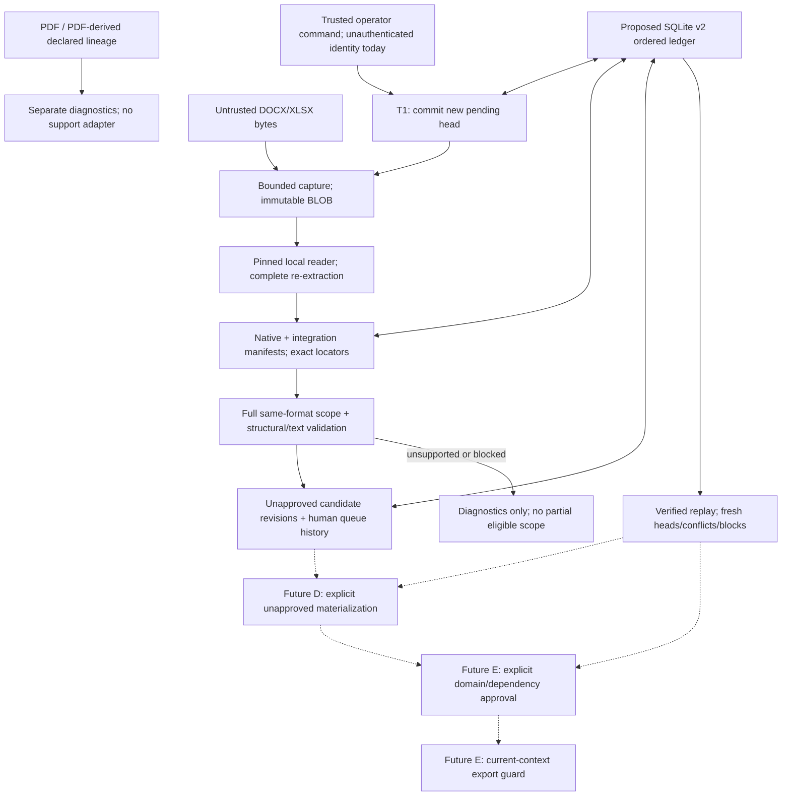
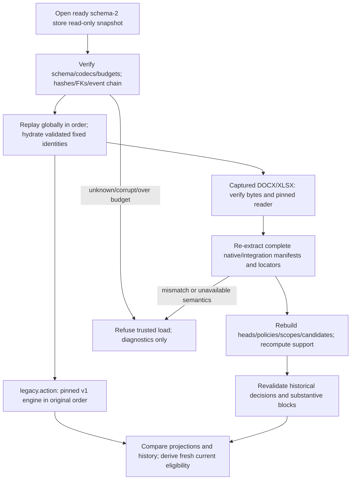

# ADR-0009: Structural evidence and SQLite v2 persistence

**Status:** Proposed for design review, TASK-007.3.0, 2026-11-10. Documentation only. Baseline inspected: `480fadf`. Every new type, codec, table, operation and gate below is a future contract, not an existing Python API or implemented schema. Review of this ADR does not itself authorize implementation, migration, document materialization, approval, real data or BSI baseline changes.

Predecessors: [ADR-0003](0003-domain-inventory.md), [ADR-0004](0004-sqlite-persistence.md) and [ADR-0008](0008-document-proposal-boundary.md). Actual verification and unresolved gates: [TASK-00730-RESULTS.md](../tasks/TASK-00730-RESULTS.md).

## 1. Scope, decision and non-goals

Recommend an additive **StructuralEvidenceV1** type for verified synthetic XLSX row support; retain legacy `Evidence` unchanged. Persist original sources and ordered commands in a separately versioned SQLite v2 ledger, reconstructing support and current eligibility from validated bytes/events rather than stored authority flags. Keep registration, queue triage, materialization, domain approval and export as distinct actions and implementation gates.

No implementation in this task: no schema DDL executed, database opened for migration, Python/test changes, dependency installation, inference, network, PDF evidence, mixed DOCX/XLSX coordinator or rendering. Existing offline tests may create/remove their already-defined temporary synthetic v1 databases; no user database is inspected or modified. This is neither production readiness nor certification/normative applicability approval.

## 2. Observed compatibility boundary

| Actual baseline API/data | Constraint the design preserves |
|---|---|
| `domain.Evidence(..., source_text=...)` | source_text is an InitVar. source_sha256 hashes exact UTF-8 text, not an Office file. SourceLocator is a text span. Boundaries and `relationship_support` are constructor-owned derived data. |
| `support.assess_source()` / `inventory-affirmative/v1` | Bounded affirmative German text grammar; no spreadsheet/header semantics. `validation.validate_response()` is also a sentence validator, not a row validator. |
| `Inventory.add/revise/record_review`, `revision_digest`, `approved_records` | Accept exact legacy record types. Named objects and Relationship use EVD references; structural records cannot enter by passing a lookalike. Fingerprints include derived evidence/current legacy source registrations, endpoints/outgoing edges and Provenance timestamps. No document-currentness guard exists. |
| `InventoryStore.commit(tuple[Write,...])`, `load`, `read_source` | Schema/event format 1; metadata/sources/events tables only. Strict add/revise/review payloads; original UTF-8 BLOBs; global contiguous sequence; BEGIN IMMEDIATE and fresh replay before writes. Unsupported versions/tables are refused. |
| `DocxStaging.begin_registration/finish_registration/register_docx` | RegistrationRef fields are source_id, **revision**, registration_id. Immutable pending/captured/terminal observations, highest revision head and exact bytes. Source VALID means reader success only. |
| `XlsxStaging.register_xlsx(..., SheetSelection(...))` | Requires explicit actual sheet identity. WorkbookSnapshot owns the integration manifest; native XlsxExtraction separately owns text/native-manifest/binary hashes. |
| `create_scope`, `assess`, `stage`, `is_eligible`, `triage` | One complete, explicitly declared scope per session, covering all known session sources. Reports are historical; live eligibility is required. QueueDecision is not a domain ReviewRecord and forbids APPROVED. |
| TASK-007.1a / TASK-007.2a | Human blocks survive unrelated changes. XLSX supports at most 100 eligible row assertions across the scope and independently 100 data rows/workbook; over-limit diagnostics retain all rows with zero proposals. |

Current staging histories are session-only. RegistrationEvent.sequence orders registration observations, not all policies/scopes/candidates/decisions; registry_epoch and reserved history units are separate counters. One cannot infer a global chronology from these separate tuples. Persist commands as they happen in future; **no automatic snapshot import of an existing live session** is designed. Public register/stage calls generate UUIDs/revisions and are not replay APIs.

## 3. Trust boundaries

Solid arrows describe the proposed persistence/staging contract, not completed software. Dashed D/E steps remain disabled until separately implemented and reviewed. A hash, manifest, actor string, stored status or successful parse crosses no approval boundary. There is no automatic model call in any stage, including reload.

## 4. Structural support choice

| Alternative | Benefit | Cost/risk |
|---|---|---|
| New tagged StructuralEvidenceV1 | Explicit different source/locator/hash semantics; independently validated constructor and codec; can bind named facts and predicates without inventing text. | Requires additive v2 domain evidence references, fingerprint policy and replay dispatcher before materialization. Existing Inventory cannot consume it. |
| Separate checked StructuralSupportBinding alongside text Evidence | Smaller-looking domain change; document provenance could remain outside legacy records. | Existing constructors still require affirmative text Evidence. A sidecar cannot make them accept XLSX without changing domain validation. Missing/detached sidecars or old callers can bypass it unless every write/review/export gains a mandatory new guard. |

**Recommendation: new structural type.** A document-to-domain binding is still needed for dependency/currentness tracking, but is not a substitute for actual support or a boolean attestation. Do not manufacture EVD text, hide JSON/base64 in source_text/provenance method strings, set `relationship_support`, or broaden inventory-affirmative/v1. No `supports=true` input is accepted.

### 4.1 Future exact typed contracts

Contract notation below lists the complete required fields for each named payload; nullable fields remain present. Strict tagged unions reject unknown/missing fields. `Id` is an opaque 32-lowercase-hex identifier unless a record prefix is specified; `Hash` is 64 lowercase hex; `N` is a positive SQLite-range integer, never bool. Ordered collections encode as JSON arrays; application records are frozen typed tuples. Paths are never source IDs or locator authority.

| Proposed contract | Required fields and rules |
|---|---|
| `document-registration-ref/v1` | Existing `{source_id, revision, registration_id}`; source_id exact nonempty UTF-8, at most 256 bytes. Store identity is supplied by the enclosing ledger, not concatenated into the existing hash preimage. |
| `implementation-spec/v1` | `{family, method_version, module_hashes, runtime, serialization_version}`. module_hashes is an ordered array of `{module_name, sha256}` covering reader, OOXML safety, stager, validation/support, shared canonical helpers and applicable domain codec; runtime is `{python_version, platform_profile, sqlite_version}` with exact strings. Hash identifies this descriptor; trusted local catalog authorizes executable implementations separately. |
| `policy-spec/v1` | `{kind, semantic_version, config, implementation_hash}`. kind is docx or xlsx; config is every explicit constructor field of that baseline StagingPolicy including all reader limits, with no omitted defaults. semantic_version is docx-single-assertion/v1 or synthetic-it-table/v1. The stored native policy fingerprint remains its exact existing computation. |
| `derivation-ref/v1` | `{registration, binary_sha256, reader_spec_hash, reader_limits_hash, native_text_sha256, native_manifest_sha256, integration_manifest_sha256}`. native_manifest_sha256 is null for current DOCX, never an invented DocxExtraction property. |
| `sheet-identity/v1` | Existing SheetSelection `{name, ordinal, sheet_id, relationship_id, part}`; exact actual sole visible IT-Systeme identity. All fields match the freshly parsed workbook. |
| `cell-quote/v1` | `{derivation, sheet, coordinate, row, column, kind, cell_text_sha256, start, end, quote}`. kind text/blank only; coordinate/row/column agree. For this profile TEXT quotes cover the complete original cell, `[0,len(text))`; quote is exact, with no normalization. BLANK has empty quote/[0,0), and is only a structural observation, never positive evidence. |
| `missing-location/v1` | `{reason, blank_cell}` with reason exactly explicit_blank and blank_cell a verified B-data-cell quote/reference. Absence, empty TEXT, placeholders and bare city strings are different invalid observations, not null. |
| `scope-dependency/v1` | `{registry_id, scope_id, scope_revision, scope_fingerprint, context_fingerprint, policy_revision, policy_fingerprint, document_bindings}`. Each binding is the exact current DocumentBinding plus registration/derivation references; sorted by source ID. Include every known source, including unresolved heads in the scope assessment. |
| `structural-evidence/v1` | `{id, revision, derivation, scope, candidate, mapping_policy_hash, sheet, row, headers, cells, missing_location}`. ID prefix SEV; candidate is `{id, revision, fingerprint, remediation_version, remediation_fingerprint}`. headers/cells are arrays of exactly three cell-quote records in A/B/C order; missing_location is null or missing-location/v1. All references must agree on the same verified registration/workbook/current candidate. |

StructuralEvidenceV1's computed support is **not** a constructor/payload field. A future checked factory must: obtain original bytes; verify digests; reparse using the trusted compatible reader; compare entire native/integration manifests; validate exact sheet/header/cell quotes; rerun the full workbook and scope; verify candidate currentness/human blocks; then derive fields and allowed predicates. Stored claims/hashes are assertions to compare with recomputation, not support authority. No arbitrary raw dictionary-to-domain converter is exposed.

Under synthetic-it-table/v1, require exact A1/B1/C1 headers and A/C complete uppercase identifiers. Require the same bounded physical-location grammar as the existing structural row validator; no name clipping or invented Rechenzentrum prefix. Derive hosts from A/C and their exact headers, and located_at from A/B only when B is valid nonempty location TEXT. Keep all three row cells and headers as surrounding structural context. A physically present BLANK B yields null/missing observation and **no** positive located_at support or Location object. Unsupported text, duplicate IDs or contradictory rows anywhere across included workbooks blocks the whole scope. Support is not general German interpretation or real-world truth.

DOCX remains the intersection of existing assess_source and validate_response over the complete unchanged paragraph. A future DOCX adapter may create ordinary legacy text Evidence from that actual paragraph, preserving its exact source_text/UTF-8 hash/quote span; it must additionally carry a separate document-currentness binding. No sentence assembled from XLSX cells may enter this path.

### 4.2 Domain and approval compatibility, future D/E only

Use an explicit future `document-domain/v2` envelope, not a silent addition to legacy RECORD_TYPES. Its named-record variant has `{kind,id,revision,name,evidence_refs,description,location_type}`; kind is it_system/it_application/location, location_type is null except for location. Its relationship variant has `{kind,id,revision,subject_id,predicate,object_id,evidence_refs}`; kind relationship, predicate only hosts/located_at, typed SYS to APP/LOC endpoints. Named IDs retain SYS/APP/LOC and relationship IDs REL conventions. No duplicate writable location/application lists on systems.

Its third variant is exactly `{kind,evidence}`, with kind structural_evidence and evidence the structural-evidence/v1 payload; identity/revision are taken from that inner record and checked against the event reference. Structural evidence is a separately validated domain record, not a Relationship constructor argument that looks like an EVD. A future DOCX text Evidence instead uses a separately tagged legacy-domain-action/v1 event with exact legacy fields/text bytes, plus a document binding committed in the same materialization transaction. It does not masquerade as a migrated action or acquire an import ID.

An evidence reference is `{kind,id,revision,fingerprint}` with kind legacy_text/v1 or structural_xlsx/v1. Legacy EVD and new SEV references remain distinguishable; validate each with its own pinned engine. V2 named/relationship records and reviews require the new codec/validator; old Inventory.add and storage._decode must continue rejecting them. Initial D uses a separate document/v2 model namespace and does not auto-merge/replace legacy/v1 named records. Every domain reference is qualified by model plus ID/revision; identity reconciliation between the two inventories requires a later explicit reviewed transition, not matching asset names or ID spelling. Edges within document/v2 use document/v2 endpoints only.

`domain-document-binding/v1` has `{model,target_id,target_revision,target_content_fingerprint,evidence_refs,candidate_refs,scope_dependencies}`. Candidate/scope arrays are nonempty exact revision references. evidence_refs is empty for evidence artifacts themselves and nonempty for named/relationship targets, preventing evidence self-reference. target_content_fingerprint covers the record's intrinsic payload before document bindings/dependency expansion, not its final recursive domain digest. Bindings are immutable and mandatory for every document-backed target. No documentless fallback is available after losing a binding. Binding a migrated legacy record is a new explicit operation with fresh document review; migration itself supplies no such binding.

Define new `document-review/v1` with `{id,target_ref,target_revision_sha256,state,reviewer_id,timestamp,reason,legacy_review_payload_sha256}`, where target_ref is `{model,id,revision}`. This future domain operation uses all four existing review-state meanings; APPROVED/REJECTED require an identified human and approval requires already-approved exact evidence/endpoints. It is not QueueDecision and is not a relabelled legacy ReviewRecord. In particular an old legacy ReviewRecord alone cannot approve newly attached document bindings. D may produce unapproved proposals only; E must implement the approval/current-context guard before document approvals can be recorded or exposed.

legacy_review_payload_sha256 is null for document/v2 targets. For a legacy/v1 target it is mandatory and addresses an explicit exact old-codec ReviewRecord: target ID and **old** revision_digest must match, and actor/state/time/reason must agree with the document review command. E atomically validates/applies that old review through the pinned v1 engine and records the separate document review with its **new** binding-aware digest. Both target hashes must be explicitly presented for review; neither review is silently invented by migration or a background adapter. This preserves v1 blocked-revision/dependency rules rather than letting a new review format bypass them. Before E these paired events are forbidden. A current legacy approval without a fresh document review is insufficient for a document-backed view.

New domain digest `document-domain-revision/v2` is H(tag, canonical object below): `{target_content, evidence_revision_fingerprints, document_binding_fingerprints, endpoint_revision_fingerprints, outgoing_relationship_revision_fingerprints}`. The last array is nonempty only for systems as applicable; arrays are deterministically sorted by qualified ID/revision. Each binding fingerprint includes exact candidate revision, full immutable scope/source/policy dependencies. Edge endpoint fingerprints use endpoint content/evidence/binding **base** fingerprints without outgoing edges, preventing recursive SYS-to-edge-to-SYS hashing. Evidence support is recomputed, not serialized as a trusted bool. Changed source, scope, candidate, evidence, endpoint or policy invalidates the current review token even when raw bytes later revert.

Legacy Inventory.revision_digest, record_data, Evidence derivation and Provenance timestamps remain byte/algorithm compatible under legacy/v1. Existing historical target_revision_sha256 values are never replaced by the new digest or assumed to be interchangeable with it. Cross-model refs and digest tags are mandatory to avoid ambiguous equal IDs or hash-policy confusion.

## 5. Serialization, versions and fingerprints

`canonical-json/v1`: strict UTF-8 without BOM; sorted object keys using the existing Python Unicode ordering, compact separators, ensure_ascii=False, allow_nan=False. No Unicode/line-ending normalization. Reject duplicate keys, floats/nonfinite numbers, surrogates, arbitrary classes and bool-as-integer. All fields and enum values are allowlisted; no pickle/eval/import-from-payload. Canonical encoding is required for new ledger payloads; migrated old payload bytes remain opaque exact UTF-8 blobs verified by the old decoder, not rewritten to new canonical spelling.

New typed fingerprints use SHA-256 of canonical JSON `{type: exact_version_tag, value: exact_hash_input}`. Raw BLOB hashes remain SHA-256 of bytes with no JSON wrapper. Preserve existing native/staging fingerprint functions **exactly** instead of applying a new wrapper to them. New records store both codec version and fingerprint version so dispatch is explicit.

| Contract/version | Hash inputs and compatibility |
|---|---|
| schema 2 / ledger-event/v2 | Separate from legacy schema/event format 1. Unknown schema or event/record/support/serialization versions fail closed. |
| docx-plain/v1 / xlsx-literal/v1 | Exact native parser results and effective limits; original raw binary and UTF-8 text hashes remain distinct. |
| docx-integration/v1 | Exact current DocumentSnapshot canonical manifest, every segment/text/hash/locator, binary digest, method/implementation/Python stamp and limits. |
| xlsx-integration/v1 | Exact current WorkbookSnapshot manifest including binary digest, full native manifest JSON and its hash, text hash, explicit selection and implementation/limits. Native XLSX manifest deliberately excludes ZIP packaging. |
| staging codecs docx-stage/v1 / xlsx-stage/v1 | Persist complete constructor inputs and recompute existing init=False fingerprints. Persist assigned IDs, revisions, session/scope IDs, registry_epoch, registration-event local sequence, policies/limits and field/quote structures; do not invent a new legacy hash algorithm. |
| docx-assertion-remediation/v1 | Exact current preimage: version, logical source, bounded original assertion system/location/application and predicate roles, or unsupported text hash. Active resource caps do not determine matching identity. Existing matching also uses the stable source-owned candidate ID. |
| xlsx-assertion-remediation/v1 | Exact current source + A/B/C presence/kind/value semantics and roles; BLANK null differs from absent/empty TEXT. Excludes coordinates, headers, other rows/sources, policy, clocks and UUIDs. Matching does not require old candidate UUID equality. |
| structural-evidence/v1 / domain-document-binding/v1 | Canonical complete fields in section 4.1/4.2, including immutable source/context/candidate dependencies, excluding computed support caches. |
| document-domain-revision/v2 | The dependency formula in section 4.2; distinct from legacy target hashes. |

Store exact existing canonical preimages alongside their hashes (or a bounded content-addressed reference), and reproduce them during replay. Registry/record IDs supplied by committed events are data to validate, not regenerated random values. Timestamps are separate audit metadata except when already included in a legacy hash; **never strip legacy extracted_at**. New event audit timestamps use aware UTC `YYYY-MM-DDTHH:MM:SS.ffffffZ`; exact legacy payloads retain original offsets/spelling and decode with pinned legacy rules. Queue timestamp monotonicity is validated per registry as today, legacy review monotonicity by the old domain engine; sequence, not clock, determines event order.

Persist full implementation descriptors, not just an informal version string. In particular XLSX implementation string 1.0.0 spans the historic scope-cap correction: explicit config and code artifact hashes are necessary to distinguish behavior. Executable compatibility handlers must come from an operator-controlled **trusted local catalog**, never Python/SQL stored in the database, arbitrary source-controlled paths or network downloads. Missing compatible code/runtime refuses replay. Retaining a descriptor/hash alone does not supply the implementation or prove its trust.

The new broader implementation-spec hash is **not** the existing native `reader_implementation_sha256`. Preserve/recompute that existing stamp exactly (Python version tuple plus reader/OOXML code-file hashes under its current algorithm) inside each integration manifest, and separately verify the broader handler descriptor. Do not overwrite a native stamp with a v2 catalog hash and call the manifest compatible.

## 6. Durable source/currentness state machine

Stable store_uuid identifies one ledger; registry_id identifies a persistent, single-format coordinator. Logical source_id is unique store-wide and permanently associated with one kind/registry; a new process cannot silently create a new identity namespace or move the same source to clear blocks. Unknown external documents are not discovered; aliases/dishonest renamed IDs remain an authentication limitation.

| Action/state | Required durable transition | Current eligibility consequence |
|---|---|---|
| Begin new source/revision | Commit unique registration ID, next source revision, predecessor, selected policy/selection; set highest-revision head PENDING. | Immediate invalidation before I/O, even with no candidate/evidence. |
| Capture succeeds | Append captured bytes/hash reference; status remains PENDING. | Still blocked. |
| Capture/parsing fails | Append FAILED with bounded codes; captured hash nullable, never invented. | New failed head stays current; no fallback to earlier valid head. |
| Reader validation succeeds | Append VALID and exact derivation/manifests under the recorded reader/limits. | Structural validity only. Full scope and queue checks still required. |
| Older work completes late | Append its terminal observation without changing the newer head. | Latest started revision remains authoritative for currentness. |
| Identical bytes registered | New identity/revision/events even if BLOB/manifest deduplicates. | Old approvals/tokens stale; unchanged human blocks still match. |
| ZIP repackaging / row move | New binary/registration/context/locator bindings. | Old approvals stale, human blocks survive unchanged substantive assertions. |
| True semantic correction | New registration/candidate revision and full deterministic validation. | New unapproved proposal only if entire scope passes and no matching block. |
| Reversion | New registration/candidate revision, never rewind a head. | Old approvals never revive; old substantive rejection/clarification matches again. |
| Changed scope/resource/mapping policy | Append activation/scope revision with immutable predecessor/dependencies. | All old currentness tokens stale. No policy-only clearing of blocks. |
| Capacity exhausted | Append explicit registry-exhausted observation; retain history and heads. | Terminal block, survives restart; no silent eviction or session reset. |

VALID/FAILED are terminal for a registration. A new attempt gets a new revision; a crash can leave a current registration pending. Recovery may append FAILED(abandoned) or finish from its **already committed** captured BLOB using its pinned implementation; it must not reopen an original mutable path as the same revision. If uncaptured bytes must be read again, start a new registration. A terminal failure cannot be retried as VALID under the same ID.

Fresh queue eligibility requires: ready verified ledger; current owned registry/scope; exact current heads all VALID with compatible reader/active policy; complete same-format coverage; at most 100 aggregate eligible assertions/100 XLSX data rows per workbook; exact recomputed fields/support; no duplicates/conflicts, resource failures or matching human blocks; exact current candidate ownership/revision. One blocking finding yields zero proposals across the initial scope. Full over-limit diagnostics can remain retained (up to bounded reader/profile limits); never slice a 101-row scope to 100 to pass.

Future approved document eligibility additionally requires a current domain binding, exact current document-domain digest, explicit human approvals for target/evidence/endpoints and every document dependency still eligible. Recompute it at read/review/export, not from cached approved rows. Pure legacy text history remains readable under pinned v1 semantics, labelled legacy-only; it gains no document dependency or approval by migration. Corruption/unsupported replay returns **no trusted partial inventory or cached approval fallback**. A correctly recorded FAILED source instead yields a verified blocked context, not a claim that the database is corrupt.

## 7. Durable queue and event contracts

Only committed chronological commands are authoritative; projections/caches must agree with their replay. Preserve full candidate data, quotes/locators/null observations/issues, assigned IDs/revisions and old decisions, including rejected/clarification-required content. No human decision is fabricated from a machine finding.

Every `ledger-event/v2` envelope has exactly `{codec,store_uuid,sequence,event_id,transaction_id,transaction_index,transaction_count,kind,payload_codec,payload_sha256,previous_event_sha256,event_sha256,occurred_at,actor_id}`. IDs are opaque validated Ids; sequence starts at 1 and is contiguous; transaction indices/counts are positive/complete and contiguous. actor_id is nonempty for commands, null only for explicit system observations. occurred_at is audit time, not ordering. Payload is a bounded separately addressed UTF-8 BLOB, not base64/source_text. event_sha256 is H(ledger-event/v2, envelope **without event_sha256**) under section 5's tagged canonical rule, including payload hash and previous hash (null only for sequence 1). This chain detects accidental changes but is not tamper-resistant against a coherent rewrite.

Proposed event families and exact payload shapes (each includes its payload_codec tag):

| Kind / payload codec | Required fields beyond payload_codec |
|---|---|
| store.initialized / store-init/v1 | store_uuid, schema_version=2, serialization_version, feature_profile=staging_only |
| implementation.registered / implementation-register/v1 | implementation_hash, descriptor_blob_sha256; local trusted catalog must recognize it. |
| registry.created / registry-create/v1 | registry_id, kind, session_id, initial_policy_revision, policy_spec_hash, baseline_registry_epoch, baseline_history_units (last two fixed 1/0). |
| policy.activated / policy-activate/v1 | registry_id, revision, predecessor_revision, policy_spec_hash, policy_fingerprint, activated_at; revision increments by one. |
| source.started / source-start/v1 | registry_id, registration, predecessor_registration_id (nullable), policy_revision, reader_spec_hash, selection (null for DOCX), declared_lineage (empty), observed_at. |
| source.captured / source-capture/v1 | registration, blob_sha256, byte_length, observed_at; at most once while pending. |
| source.validated / source-valid/v1 | registration, derivation_id, observed_at; exactly one terminal event and complete verified derivation. |
| source.failed / source-fail/v1 | registration, phase, issue_codes, observed_at; phase is capture/reader/manifest/environment/interrupted/capacity. Raw BLOB comes only from an earlier capture, else absent. |
| registry.exhausted / registry-exhaust/v1 | registry_id, budget_name, observed_at; terminal, not a new review state. |
| scope.assessed / scope-assess/v1 | registry_id, scope_record, context_record, staging_codec, policy_spec_hash; all exact constructor inputs and claimed existing fingerprints in the two records. |
| candidate.staged / candidate-stage/v1 | registry_id, staging_codec, candidate_record, remediation_version, lineage_key; exact constructor inputs and fingerprints. |
| queue.decided / queue-decision/v1 | registry_id, decision_record, remediation_version; decision_record is exactly the existing QueueDecision constructor fields. |
| legacy.import_started / legacy-import/v1 | import_id, snapshot_sha256, original_schema, original_event_format, original_support_policy, compatibility_spec_hash, original_event_count, source_count, source_manifest_sha256. |
| legacy.action / legacy-action/v1 | import_id, original_sequence, operation, original_payload_blob_sha256, source_ref (null or exact source_id/text hash). Preserve original payload bytes and typed old semantics. |
| legacy.import_completed / legacy-complete/v1 | import_id, original_event_count, source_count, verified_legacy_view_sha256, certificate_blob_sha256. |
| domain.materialized / document-domain/v2 (D disabled) | model, operation (add/revise), record_ref, record_payload_sha256, binding_ref, expected_context_fingerprint. No approval state inferred. |
| legacy.domain_action / legacy-domain-action/v1 (D disabled) | operation (add/revise), original_payload_blob_sha256, source_ref, compatibility_spec_hash, binding_ref, expected_context_fingerprint. Initially only real DOCX-backed legacy Evidence is allowed here; exact old codec/constructor, no invented import identity or legacy approval. |
| domain.reviewed / document-review/v1 (E disabled) | review_record; exact section 4.2 fields. |

The embedded scope/context/candidate/decision records use their exact selected docx-stage/v1 or xlsx-stage/v1 field sets from the baseline dataclasses (including row only for XLSX), not a union accepting arbitrary fields. init=False hashes are encoded as claimed values and recomputed; no derived caches are trusted. Include all existing field/missing/claim/source locators and policy configuration, not just extracted values. Scope-assessment and all its candidate events form one complete batch transaction; diagnostics and eligible projections cannot be partially published.

registry.created owns initial policy activation revision 1 (including its spec and initial fingerprint); policy.activated applies only from revision 2 with a non-null previous revision. This avoids circular genesis events and reproduces the current initial epoch. Imported compatibility specs may be owned by legacy.import_started without extra prefix events, preserving the fixed migration sequence mapping. Registry epoch/local-registration sequence and history-unit increments are reproduced under the pinned stager; they are not replaced by the global event count. Candidate event state is the machine validation state; the effective human queue disposition is derived from decisions, not an in-place candidate rewrite.

The trusted runtime has an explicit feature allowlist: A accepts source/codec events only; B adds queue/manifests; C adds legacy import; D adds unapproved domain actions; E adds guarded domain reviews. A database flag/event alone cannot enable an unavailable or unreviewed feature. Store feature_profile describes the initial staging-only baseline, not permission to skip unsupported event kinds later. A build lacking a required handler must refuse the ledger.

Lineage keys preserve existing DOCX source-owned candidate IDs, and XLSX unique source/asset versus ambiguous row-slot histories. Persist keys and verify them against reconstructed original rows; don't derive ownership from a filename or candidate-supplied flags. Human block matching uses pinned remediation semantics: DOCX stable candidate ID plus key, XLSX source-bound key even when duplicate cleanup/relocation creates another candidate ID. A policy/codec upgrade must retain/check all historical compatible blocking keys; unknown old remediation semantics blocks the affected registry, never clears history. No generic unblock/reset/APPROVED queue event exists.

Queue decisions require explicit reviewer ID, reason, aware timestamp and exact current candidate/context fingerprints at the event's historical position. Later source updates make old decisions historical without invalidating their historical authenticity-as-data. An APPENDED PROPOSED decision cannot override an earlier matching REJECTED/NEEDS_CLARIFICATION key. True corrections must be revalidated, and reverting substantive content restores the block. Persist context membership, slot/ID ownership, policies/activations, reader artifacts, local registration sequence/epochs, history reservations/exhaustion and all source bytes to reconstruct this after restart.

## 8. Conceptual SQLite v2 relational model

This is a schema proposal, **not runnable DDL or an existing database**. Use typed columns/check constraints/foreign keys plus strict application codecs; JSON-only foreign-key declarations do not provide referential integrity. All source/record IDs use binary/exact case-sensitive comparison. BLOBs contain actual bytes; manifests/JSON have separate explicit content kinds. Never reuse v1 sources.content for binary documents or opaque payloads.

| Proposed table | Key / main foreign keys / integrity |
|---|---|
| store_metadata | singleton PK; store_uuid UNIQUE; schema_version=2, event_codec, serialization_version, build_state, last_sequence, last_event_hash. Head/build state updated only in validated transactions. |
| content_blobs | sha256 PK, byte_length, content BLOB; verify length/hash independently before decode/use. Immutable dedup; type declared by referencing table, not trusted by filename. |
| implementation_specs | implementation_hash PK, descriptor_blob FK content_blobs. Descriptor hash and trusted local catalog match. Immutable. |
| policy_specs | policy_spec_hash PK, implementation_hash FK, kind/version/config BLOB FK; includes complete resource/semantic configuration. Immutable. |
| registries | registry_id PK, session_id UNIQUE, kind docx/xlsx, created_event FK; immutable ownership. Mutable epoch/exhaustion/history counters live only in verified projections. |
| logical_sources | source_id PK store-wide, registry_id FK, kind, created_event FK; immutable association, kind matches registry. UNIQUE(registry_id,source_id) for composite FKs. |
| registrations | registration_id PK; UNIQUE(source_id,revision); composite FK(registry_id,source_id); predecessor registration FK with same source and exact previous revision; start_event UNIQUE FK; policy_revision FK policy_activations; selection BLOB FK. Immutable. |
| registration_observations | event_sequence PK FK events; registration FK; observation pending/captured/valid/failed; nullable captured_blob FK; nullable derivation FK; bounded issue payload FK. Capture/terminal uniqueness via partial UNIQUE indexes; state/event order verified in code. |
| source_heads | source_id PK FK; composite FK(source_id,revision,registration_id) registrations; last_event FK. Rebuildable current-head projection, never separate truth. |
| policy_activations | PK(registry_id,revision), policy_spec_hash FK, activation_event UNIQUE FK, activated_at; strictly increasing predecessor validated. Immutable. |
| derivations | derivation_id PK; registration_id UNIQUE FK; raw_blob FK; implementation_hash FK; reader_limits hash; native_text hash; native_manifest BLOB/hash nullable for DOCX; integration_manifest BLOB/hash required; observed_event FK. Complete bytes/limits/locators must reproduce. |
| scope_revisions | PK(registry_id,scope_revision), scope_id, scope_fingerprint, policy_revision FK, epoch, event FK; scope ID remains stable within registry. Immutable. |
| scope_members | PK(registry_id,scope_revision,source_id); FK scope_revisions; nullable registration FK for a declared unknown source; declared source_id is literal when unresolved, not a fabricated logical_sources row. Known source association must match registry. |
| assessments | context_fingerprint PK; scope revision FK; content fingerprint, canonical context payload BLOB FK; event FK. Explicit source-document bindings in assessment_bindings; immutable failures retained. |
| assessment_bindings | PK(context_fingerprint,source_id); context FK; exact registration/derivation FKs and DocumentBinding fingerprint. Validate no other source/revision is substituted. |
| candidate_revisions | PK(candidate_id,revision); UNIQUE(candidate_id,fingerprint); registry/context FKs; binding FK via context/source; staging codec, nullable XLSX row, lineage key, remediation_version/key, payload BLOB FK, event FK. ID type/owner/revision continuity enforced. |
| candidate_dependencies | PK(candidate_id,revision,derivation_id); FKs candidate revision/derivation; scope membership is additionally bound by context. Immutable, recomputed links. |
| queue_decisions | decision_id PK, exact candidate revision/fingerprint/context FKs, registry, remediation_version/key, state CHECK proposed/rejected/needs_clarification, reviewer/timestamp/reason, event UNIQUE FK. Immutable. |
| structural_evidence_revisions (D disabled) | PK(id,revision), fingerprint UNIQUE, candidate revision/context/derivation/policy FKs, payload BLOB FK. Exact structural quotes reference existing verified derivations. No writable support boolean. |
| domain_revisions (D disabled; legacy subset populated by C) | PK(model,id,revision); unique model/id/revision/type continuity, codec/payload/hash/event FK. Base identity table for legacy records and document/v2 records, including SEV; structural_evidence_revisions is a composite-FK subtype of the SEV base row. legacy/v1 and document/v2 dispatch separately. |
| domain_source_bindings (D disabled) | binding fingerprint PK; exact domain revision FK; binding payload FK. Normalized children binding_candidates, binding_contexts and binding_evidence carry real composite FKs to their exact revisions. |
| domain_reviews (E disabled) | review ID PK; target model/ID/revision FK; target digest/version, reviewer/time/reason/state; nullable legacy-review payload BLOB FK; event FK. Imported legacy reviews stay in their original action stream; no overwrite. New paired legacy reviews are additionally indexed in legacy_domain_actions under the same atomic event. |
| text_sources | PK(source_id,source_sha256), exact strict UTF-8 blob FK; legacy text contract only. Covers imported text and future real DOCX-paragraph Evidence without hiding document bytes. |
| legacy_imports / legacy_sources | import_id PK with certificate/snapshot/policy refs; sources PK(import_id,source_id,source_sha256) with composite FK text_sources. No document registration fabricated. |
| legacy_actions | PK(import_id,original_sequence); global event UNIQUE FK; operation/payload/source FKs. Keep legacy original sequence independent of v2 prefix events. |
| legacy_domain_actions (D/E disabled) | global event PK/FK; exact old payload/source refs and mandatory domain binding FK; no import_id or fabricated original migration sequence. D accepts Evidence add/revise; E additionally indexes the explicit paired legacy review from domain.reviewed (source_ref null). |
| events | sequence PK, event_id UNIQUE, transaction_id/index UNIQUE, strict envelope/payload refs, previous hash; complete contiguous order agrees with metadata. Authoritative append-only chronology. |
| current_projection_heads | PK(registry_id,projection_kind); last validated sequence/hash, context/current candidate refs, epoch/exhaustion/counter cache. Rebuild and compare; corruption causes refusal, no approval cache authority. |

Every immutable row and referenced BLOB must be owned/referenced by committed events; reject orphan rows, extra unrecognized tables, dangling FKs, impossible subtype combinations and altered payload-to-row mirrors. Events and row mirrors are one logical write, not independent stores. Composite referenced columns require matching UNIQUE indexes even where a shorter primary key exists; temporal/state constraints not expressible by FKs are mandatory replay checks. Deferrable FKs permit event/derived-row insertion in the same transaction; no dependency may point to a future transaction. All history UPDATE/DELETE is refused through triggers/API. Mutable metadata/projections are atomically updated with events and verified on reload. No retention deletion/compaction in the first prototype.

In schema 2 these conceptual domain tables may exist empty; their presence is not activation. C may populate only legacy namespace history from verified wrappers; D/E event handlers remain unavailable until their separate gates pass. Every evidence-ref child FK resolves to the qualified base domain revision, and subtype/model checks distinguish legacy EVD from document SEV. A domain materialization owns its record, structural subtype if applicable, binding and reference children in one transaction; it cannot commit a detached sidecar or unbound record.

## 9. Transactions, concurrency and interruptions

Database path is explicit trusted local operator configuration outside Git, never a source-controlled path. First persistence implementation keeps original document BLOBs **inside the same SQLite database** to permit atomic blob/reference commits; a future external source store needs a separate durability protocol. No promises span unrelated files, databases, network drives or exports. Y:/ is the repository location, not proof that a chosen database volume provides reliable local SQLite locking/durability.

| Transaction boundary | Work and failure behavior |
|---|---|
| T1 register pending | BEGIN IMMEDIATE; verified replay, compare expected store head/source predecessor, reserve capacity; append source.started and update highest-revision head PENDING; commit **before** capture/parsing. A stale command or busy lock commits nothing. |
| T2 capture | Read original exactly once outside writer transaction, bounded by recorded policy. BEGIN IMMEDIATE; confirm own registration pending; atomically insert/deduplicate bytes and source.captured; commit. Capture failure instead appends terminal FAILED with no invented blob/hash. |
| T3 parse terminal | Parse the committed immutable BLOB outside the writer lock through closed temporary copy outside Git. In a short write transaction validate pending/capture/recorded specs and append VALID+derivation or FAILED. A late older terminal may commit history, never roll a head back. SQL failure leaves the prior pending state, not the old valid head. |
| T4 assessment/candidates | Build against a consistent read head; BEGIN IMMEDIATE, revalidate that expected head/policy/scope/ownership still match; commit complete scope assessment + every candidate event/projection as one batch. On stale/invalid/write error, roll back all new rows/events/head metadata. No first-100 partial batch. |
| T5 queue decision | Fresh locked replay/current eligibility/blocks and exact candidate/context/head tokens; append explicit human decision. If changed, refuse; no automatic retry with an old token. Registry-scoped nondecreasing reviewer time retained. |
| T6 materialization/review (later D/E) | Separate explicit commands, each atomically checking current source/queue/domain dependencies and expected ledger head before any domain event. Materialization does not enqueue implicit domain approvals. |
| Future export guard (E) | Render only from a verified consistent read snapshot into quarantined output; immediately before publication recheck expected ledger head, all bindings and approvals and issue a single-use ledger-bound authorization/receipt. A stale token refuses publication. Database receipt and unrelated filesystem file delivery are not one atomic operation. |

Use one connection per thread, foreign_keys ON and verified, trusted_schema OFF, synchronous FULL, timeout=0 and explicit BEGIN/BEGIN IMMEDIATE; this follows the existing consistency posture and does not change workstation security settings. Exact schema/PRAGMA behavior and crash durability require target-filesystem tests before use. Busy/locked means no new transaction committed; caller explicitly reloads/reconsiders. Assign global sequences under the write lock. Recompute eligibility under that lock for writes rather than trusting a boolean read earlier. Idempotent retries require the exact same already-committed command/event ID and byte-identical payload; a different payload with reused ID is an error, not a merge.

Reserve one bounded terminal-control event per registry outside its ordinary history-unit quota. A capacity violation must commit registry.exhausted before reporting that terminal outcome; do not throw inside a transaction that then rolls back the invalidating observation. Roll back incomplete data work first if necessary and commit the control observation separately. If even the invalidating write cannot commit (disk/DB unavailable), report failure/uncertain availability and expose no cached trusted view; do not claim a new durable head/exhaustion exists. A begin-registration command is acknowledged only after T1 commits. Uncommitted intent cannot be promised as a cross-process durable invalidation.

Crash after T1: pending survives restart, blocking dependencies. Crash after T2: resume from committed bytes or fail abandoned; no mutable-path reread. Crash in T3/T4/T5: SQLite exposes complete transaction or none; if a failed-terminal transaction rolls back, PENDING still blocks. Another newer registration may start during parsing; older results remain historical. Crash after commit but before acknowledgment: reconcile by command ID and current replay before considering any new write. Currentness/approval caches cannot bypass these rules. Exported files after later source changes remain historical artifacts; the guard cannot recall copied files or promise permanent approval.

## 10. Explicit v1-to-v2 migration

Migration is a separate future operator-invoked **offline copy/import**, never in-place or startup-triggered. Source v1 remains intact and usable on failure. Do not open arbitrary databases by using current InventoryStore as a read-only verifier: its constructor initializes/checks under a write transaction. A purpose-built read-only migration reader must reuse the pinned v1 decoding/domain rules without that lifecycle; audited validation of a disposable consistent snapshot is an alternative.

1. Operator stops source writers, chooses distinct resolved source/snapshot/new-output paths outside Git, and confirms exclusive creation of the target. Never overwrite the source, existing target or unrelated file. Validate local filesystem/backups and available space first; no automatic deletion/repair.
2. Open the source read-only under trusted operator path handling; obtain a consistent SQLite backup/snapshot using SQLite's backup facility, not a naive copy of a live .db while ignoring WAL/journal files. The read-only migrator's controlled URI handling is new tooling, not a claim that existing InventoryStore accepts SQLite URIs.
3. On the consistent snapshot verify integrity_check, foreign_key_check, exact v1 schema/metadata/versions/support policy, strict UTF-8 sources/digests, event counts/order/reference coverage and full pinned typed replay. Record snapshot hash, exact source-byte manifest, ordered payload bytes, old metadata and implementation fingerprints. Retain/quiesce original until activation decision. Never change the v1 source's schema/user_version/data during this process.
4. Exclusively create separate schema-2 target with build_state=building. Normal readers/writers must refuse it until finalized. In a new target ledger append store.initialized then legacy.import_started, declaring the original counts/certificate inputs. No document source, candidate or structural evidence is invented.
5. Import each original event as a legacy.action wrapper in original order, preserving original_sequence, operation, raw payload UTF-8 bytes, nullable exact source reference and original text source BLOBs. Original sequence i maps to v2 global sequence i+2 for this initial migration profile. Source blobs are inserted on first reference; orphan v1 sources are corruption. Each wrapper dispatches through pinned v1 _decode/_apply-equivalent behavior, including historical review/source interleaving. UUID/ID/revision/reviewer/timestamp/reason/hash values remain unchanged.
6. Replay target independently and compare every historical review target, every original source byte, event mapping/count, record/review histories and final legacy revision_digest/review_state/approved_records with the verified v1 snapshot. Preserve exact source Unicode/line endings and offset-aware Provenance times. Hash of the backup's physical SQLite file identifies that snapshot; it need not equal the source database's physical layout after SQLite backup. Logical/source/payload equality is the migration criterion.
7. Import may use bounded transactions only while build_state=building; an interruption leaves a quarantined unusable target, not a partly migrated current store. No silent startup resume. Default recovery is explicit verification followed by a new separately named target; a resumable importer needs its own validated checkpoint contract before use.
8. After all N actions, append legacy.import_completed at sequence N+3 with verified certificate and atomically mark ready. Close/reopen through the independent verified v2 loader; confirm the certificate and comparison again. Empty v1 stores use the same profile with N=0. Insufficient replay budgets, missing compatible implementation or any mismatch aborts readiness; source remains usable.
9. Operator explicitly switches application database configuration only after all checks succeed, with writers still quiescent. No atomicity is promised between two database files or configuration. Keep v1/snapshot for rollback; once new v2 writes exist, reverting to v1 would discard those new actions and is not a transparent rollback. Do not pretend old v1 writers can safely operate on v2: their existing user_version/exact-table checks must refuse it.

Migration keeps schema-1 event codec/support/fingerprint semantics pinned. It does not reinterpret text sources as DOCX/XLSX originals, reconstruct missing originals from a quote/hash, convert old approvals into document approvals, or apply new table semantics to historical EVD records. A migrated approved legacy record stays an approved **legacy-only** historical/current legacy view under its old semantics; new document bindings require new explicit validated revisions/reviews. No auto-materialization follows import completion.

For reproducible comparison, `legacy-view-summary/v1` has exactly `{current_records,record_histories,review_history,source_rows,event_rows}`. current_records is sorted by ID with `{id,type,revision,legacy_revision_digest,review_state}` from the pinned final Inventory. record_histories is sorted by ID with `{id,revisions:[{revision,payload_sha256}]}`; hashes address the exact corresponding original action payloads. review_history preserves review event order with `{id,target_id,target_revision_sha256,payload_sha256}`. source_rows is sorted by source ID/hash with `{source_id,source_sha256,byte_length}`. event_rows is sequence-ordered with `{original_sequence,operation,payload_sha256,source_ref}`. References/hashes link to exact retained sources/payloads; no new serialization of original source text is substituted. The verified_legacy_view_sha256 is the tagged canonical hash of this summary, supplemented by byte-for-byte comparison of all referenced BLOBs.

`migration-certificate/v1` has exactly `{import_id,source_snapshot_sha256,source_metadata,compatibility_spec_hash,event_count,source_count,source_manifest_sha256,legacy_view_summary_sha256,prefix_event_count,verification_spec_hash,verified_at}`. source_metadata preserves v1 schema_version/event_format/support_policy/last_sequence; prefix_event_count is 2. The source manifest is the canonical ordered source_rows summary; verification_spec_hash identifies the trusted comparison tool. The certificate is retained audit evidence, not a signature or approval. Counts, summary and references are independently verified again after reopen before activation.

## 11. Verified reload/replay

1. Validate schema 2, ready/import certificate, supported event/record/serialization/support versions, strict schema table/index/trigger allowlist and declared size budgets before materializing payloads. Run integrity/FK checks and compare counters with actual rows.
2. Verify all retained BLOB lengths/hashes and referenced UTF-8 before using them, including failed-capture diagnostics if present; reject orphans/missing data. Document binaries remain binaries; legacy text decodes strictly after byte verification.
3. Stream contiguous events in one consistent read transaction. Verify envelope canonical hashes/chain, complete transaction groups, unique IDs, no forward dependencies into a later transaction, and last_sequence/hash. Validate recorded times with their policy, never sort by them.
4. Reconstruct persistent registry IDs, initial policy, counters/epochs and local registration-event sequence. Hydrate validated event-supplied UUIDs/revisions; don't call existing public registration/stage APIs to generate new ones or deserialize __dict__/pickle. Compare every claimed existing staging hash with a fresh computation from its exact preimage.
5. On captured sources use bounded immutable BLOBs with the pinned trusted reader/limits; reconstruct complete native artifacts. Match exact raw bytes, native text, XLSX native manifest, integration manifest, selection, every segment/sheet/row/cell/kind/text/hash/locator. Current DOCX has no native manifest attribute. Content-deterministic reader/manifest failures must reproduce under their pinned rules; environment/interrupted/uncaptured OS failures remain historical bounded observations, not a reason to reopen paths or reactivate a failed registration if parsing now succeeds. Verify retained bytes even for such failures. A historical capture failure can have no bytes; a VALID derivation cannot.
6. Rebuild source heads by highest started revision, not terminal event time. Pending/failed observations are legitimate replayed blockers. Restore exact policy activations and scope membership, including unresolved sources; recompute complete assessments, duplicates/conflicts and 100-row aggregate eligibility. Resource overages remain blocked with complete diagnostics, never first-N eligibility.
7. Recompute candidate fields/null observations/claims using the appropriate deterministic DOCX or XLSX adapter and exact stored IDs/lineage. Recompute both currentness and substantive remediation keys under their separate pinned versions. Comparison-only derivation of a block key cannot grant proposal support.
8. Revalidate each QueueDecision at its historical ledger position against its then-current candidate/context and metadata. Retain every REJECTED/NEEDS_CLARIFICATION binding through subsequent changes; replay cannot reset candidate identity or drop an old key to clear it. Policy activation/new source/row movement does not create human reconsideration authority.
9. For legacy.action use original source bytes and pinned old typed constructor/replay; compare original old fingerprints at each historical review. Do not replay all records before reviews or apply current document policy retroactively to v1. Never regenerate a model response: stored model output, if a future separately authorized codec permits it, is untrusted input to validate, not a call to inference. Today's staging is deterministic only.
10. In future D/E, independently reconstruct structural evidence from original verified bytes and domain bindings, derive predicate support and replay explicit domain reviews with dependency ordering. A-only/B-only stores cannot activate those event kinds; unsupported enabled features refuse the store instead of skipping them.
11. Compare normalized rows/projections with replayed state. Derive current eligibility/approved-document view separately from historical decisions at the final committed head. A mismatch returns no trusted partial view; an expected pending/failed/conflicting source returns a verified blocked scope.
12. Expire projections after any new committed event or external store identity/head change. Every write gets fresh locked replay/tokens; every current read/export gets a consistent verified snapshot. No cached approved snapshot fallback after an error.

### Replay budgets

Proposed first synthetic ledger limits, subject to the review gate before A: file at most 256 MiB; at most 10,000 events and 4 single-format registries; at most 8 MiB per canonical event/manifest payload, 128 MiB aggregate payload bytes, 32 MiB unique original document bytes and 32 MiB retained integration manifests; at most 1,000,000 current scope characters; read/write arrays/counts checked before construction. Readers retain all existing ZIP/XML/cell limits (2 MiB original document, etc.); no parser limit is relaxed to load a larger history. Initial legacy source migration limit is 1 MiB per exact UTF-8 source and 32 MiB aggregate; a larger valid v1 store is refused without changes and requires a separately reviewed larger replay profile, not truncation.

Preserve each registry's existing 16-source cap, DOCX 512/XLSX 2,048 history-unit budgets, retention caps and exhaustion state. XLSX eligibility remains 100 rows total and per workbook; up to 1,600 row diagnostics (16 bounded workbooks) can be retained for blocked scopes, and count/byte budgets still apply. JSON depth at most 64 and 100,000 nodes/payload; reject larger input before unbounded recursion/copying. Stream events, but verify the entire required history; no unverified tail or partial approval. Use a 60-second monotonic replay deadline checked between bounded reader/events; exceeding it fails closed and yields no view. This is not an interruptible hard OS timeout/RSS guarantee; choose lower budgets if hardware measurements require it.

No silent history compaction, truncation, source deletion, trusted checkpoint shortcut or old-policy substitution. Long-lived budget upgrades must preserve all blocks and require an explicitly reviewed profile; restarting cannot reset limits/history. Test these proposed budgets on the recorded low-memory Windows environment before real use; performance is an open rollout gate.

## 12. Threat and failure matrix

| Threat/failure | Required result / residual limit |
|---|---|
| Forged support boolean, clipped ID/location quote, invented sentence | Reject unknown fields; rederive exact full-cell/header support from raw bytes. No legacy Evidence shim. |
| Native manifest correct but original ZIP changed | Integration/binary/registration mismatch; no eligible current view. Repackaging requires new registration. |
| Edited cell kind BLANK vs absent/empty TEXT | Native manifest/row semantics differ; only verified explicit BLANK gives null. |
| Additional sheet/row/cell, duplicate/conflicting workbook | Reader/profile/scope fails; no partial first-100 output. |
| Pending/failed new head or crash before parse | Durable blocker; never retain old head as current because no new candidate exists. |
| Unrelated policy/row/source change or relocation | Currentness tokens stale; substantive human block still matches. No APPROVED queue state. |
| Reversion to rejected content | New revision required; old block applies again, old approval does not revive. |
| Reordered/deleted/duplicated events, missing source/dependency | Sequence/hash/FK/replay failure; no partially verified inventory/cache fallback. |
| Unknown schema/codec or absent old implementation | Refuse trusted open/migration; no best-effort reinterpretation or network fetch. |
| Concurrent writer/stale review/export token | Busy or stale error; rollback whole command, explicit reload required. |
| Interrupted migration/disk full | Source v1 untouched; target building/quarantined or complete-ready only. No startup auto-upgrade. |
| Coherent DB/event hash-chain rewrite | Hashes/triggers cannot authenticate it. Protected access, independently anchored audit/signatures needed later. |
| False reviewer/source ID or concealed copied/PDF lineage | Current IDs unauthenticated; trusted operator/source access controls required. No PDF promotion override. |
| Malicious trusted process or hostile SQLite file | Frozen records are not process isolation; operator-controlled local DB and runtime remain prerequisites. |
| Old exported/copied file after source change | Ledger view becomes ineligible; cannot revoke independent copies or promise cross-filesystem atomicity. |

## 13. Future implementation decomposition and test gates

These are proposed tasks **after design review and a new explicit implementation request**. No task below is started by this ADR.

| Stage | Scope and dependencies | Exit gate |
|---|---|---|
| A — codec/source/event store | First task. Implement versioned strict codecs, raw BLOBs/specs, globally ordered source/policy/registry events, pending-before-I/O transactions, schema/version refusal and append-only constraints. No trusted queue/domain/approval projection yet. | Independent codec vectors; exact bytes/order; FK/hash/orphan/rollback/busy/crash tests; staging-only feature whitelist; no Evidence/Inventory/model calls. |
| B — verified manifests/queue replay | Requires A. Pinned reader hydration, full native/integration reconstruction, scope/candidate/history records, remediation and fresh eligibility. | All 417 current regressions retained; new restart/spoof/corruption/stale/cap/block-replay matrix below; no domain events accepted. |
| C — explicit offline migration utility | Requires A+B and audited pinned v1 compatibility reader. Separate operator tool, not application startup. | Original/snapshot/target comparisons; old approvals/fingerprints/order exact; interrupted/failed migration safe; old writer refuses v2; no invented document bindings. |
| D — structural evidence/domain integration | Requires B and reviewed section 4 contracts (C if imported legacy history is included). Implement tagged StructuralEvidenceV1, explicit unapproved document/v2 records and source bindings. | Recomputed exact header/cell/predicate support; IDs/refs/conflicts/digests; unknown support flags/types refused. No domain APPROVED action/export until E. |
| E — current-context domain review/export guard | Requires B+D (and C for migrated data). Implement explicit dependency-ordered domain reviews and point-of-publication currentness checks, not rendering itself. | Pending/failed/changed heads invalidate every dependent approved view; stale writes/reviews/export refused; historical decisions retained; no cross-file atomicity claim. |

A is the recommended next implementation task only after this design is reviewed. Persistence must not silently enable D/E. Mixed-format scopes, authenticated identities/audit, general document compatibility, OCR, RAG and renderer implementation are separate future work.

### Focused persistence test matrix (proposed, not executed tests)

| Test group | Required assertions / earliest stage |
|---|---|
| Strict codec vectors | Canonical Unicode/CRLF, duplicate keys, bool/int, floats/NaN, unknown/missing fields/versions, max sizes, IDs and exact old hashes; A. |
| Byte retention | Capture once, explicit BLANK/text/manifest distinctions, private temp cleanup, no paths/source text as authority; A/B. |
| Pending/terminal crash | Kill/reopen after T1 and T2; head stays pending/failed; resume only committed bytes; late old terminal never replaces newer; A/B. |
| Atomicity/concurrency | Fault each source/event/projection insert; no partial batch; two writers; stale tokens; duplicate idempotency ID with altered payload; A/B. |
| Manifest/support replay | Mutate binary, native/integration manifest, sheet ID, coordinate, cell hash/quote/header/type/row; no trusted load; positive support never read from bool; B/D. |
| Scope caps/conflicts | One XLSX 100; two totaling 100; 101 blocked with all diagnostics; tighten/restore max_scope_rows; duplicates/conflicts/pending/failed across all sources; B. |
| Human block restart | Both blocking states across ZIP repackaging, row movement, duplicate cleanup, unrelated source/row/policy changes, absent field emission, true correction and reversion; IDs/history unchanged; B. |
| Event corruption | Gaps/reorder/delete/unknown codecs, orphan raw source, wrong projection/metadata/transaction group, future FK dependency; all fail closed; A/B. |
| Legacy import | Exact source/payload bytes and timestamps, review-before-revision interleaving, negative support, old fingerprints, empty store, old writer refusal, missing old code; C. |
| Migration interruption | Disk-full/cancel at each import transaction; v1 still readable and unchanged; target never usable before ready; independent post-reopen verification; C. |
| New domain/support | Partial IDs/negative/unmapped values, invalid SEV links, hidden sidecar bypass, false support flag, unsupported cross-model refs, dependencies/outgoing-edge digest changes; D. |
| Approval/export freshness | Source pending/failed without new proposal, identical re-registration, reverted bytes, scope/policy changes, stale guard token and filesystem delivery failure; no cached approval fallback; E. |
| Resource and side effects | Above-cap event/history/blob/JSON/deadline; no truncation/no automatic model calls; raw diagnostics never approved/exported; A–E. |

## 14. Review decisions, unresolved gates and residual risks

Review must ratify the new tagged structural type, separate document/v2 domain namespace and approval codec, in-database original BLOB choice, event/payload/table contract, migration certificate/order mapping and proposed replay budgets. These are concrete recommended contracts, not implemented or authenticated approvals. Availability and retention of trusted compatibility implementations/runtime must be demonstrated before A/B/C activation. No codec may silently fall back if a historic implementation is unavailable.

The applicable normative BSI baseline remains pending authoritative confirmation. The synthetic table mapping and location/conflict rules are engineering assumptions. No claim of real-world truth, source authenticity, reviewer authentication, complete Office visual compatibility, production readiness or certification compliance follows from this ADR or the passing offline suite.

Before real-document deployment, separately design and validate operator/reviewer authentication and authorization, protected local source custody/lineage, stable identity assignment, filesystem/database/backup access controls, recovery/retention/deletion, trusted code distribution/upgrade, independently anchored audit integrity and UI escaping/approved-export handling. Hash chains alone are insufficient. Do not implement these security mechanisms or change workstation settings in this task.

Current staging is session-only; persistence/replay described here does not yet exist. There is no mixed DOCX/XLSX scope coordinator. PDF still lacks independent visual verification and remains categorically excluded from evidence. Performance under low available RAM, target database filesystem locking/durability, reviewer ownership and future cross-model identity reconciliation remain release gates. Review of this documentation is the next step; no schema-v2 migration or domain integration has been performed.
